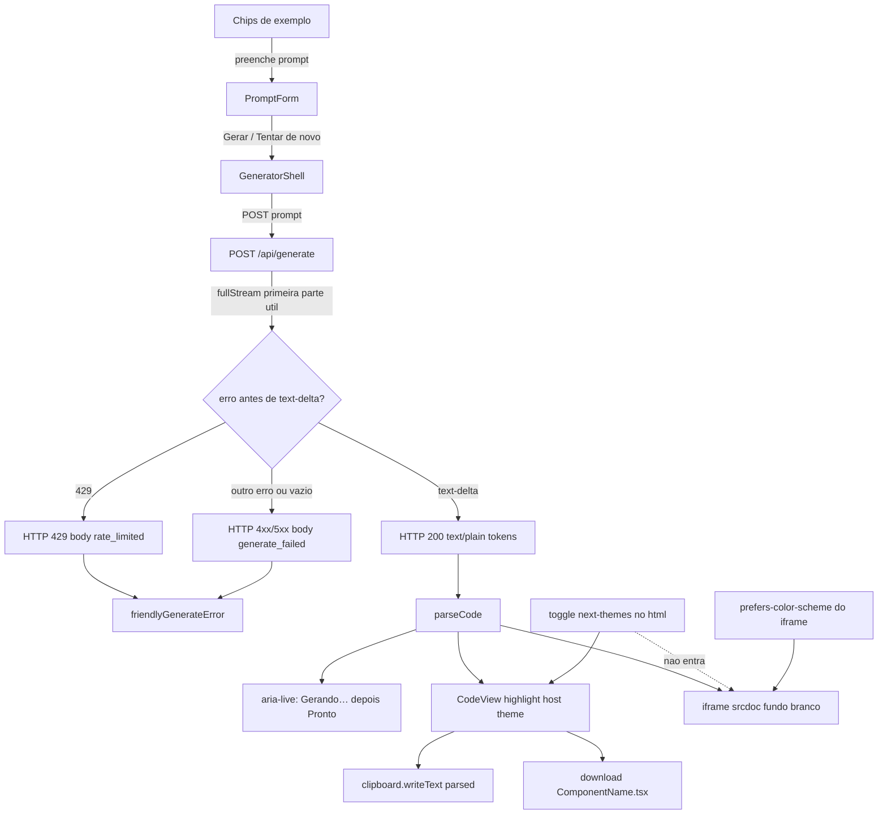

# Phase 3: Export, Examples & Accessible UX - Research

**Researched:** 2026-10-15
**Domain:** UX de exportação, tema persistido e acessibilidade sobre o loop generate→preview já existente (Next.js 15, AI SDK text stream, iframe srcdoc)
**Confidence:** HIGH

## Summary

A fase não introduz biblioteca nova. Galeria, copiar/baixar, abas e o alerta de retry são UI em cima de `GeneratorShell`, `PromptForm` e `CodeView`. Tema usa o `next-themes@0.4.6` já montado em `src/app/layout.tsx`, com `enableSystem={false}` e o script bloqueante que o provider já injeta (não escrever outro anti-FOUC). Highlight do código troca `themes.nightOwl` por `themes.nightOwlLight` quando o tema resolvido é `light`.

O ponto que o plano não pode errar é o 429. `useCompletion` com `streamProtocol: "text"` só enxerga `APICallError.statusCode` quando a rota devolve HTTP não-OK **antes** do body. `result.toTextStreamResponse()` responde 200 e **ignora** partes que não são `text-delta` (o JSDoc de `ai@7.0.141` diz isso). Um 429 do Gemini vira conclusão vazia ou stream quebrado, e a UI cai no texto genérico — ou pior, não mostra erro. A rota precisa ler `result.fullStream`, e se a primeira parte útil for `type: "error"` com status 429, responder `new Response("rate_limited", { status: 429 })`. O cliente traduz isso para a cópia travada e nunca mostra `error.message` cru.

O segundo ponto é o preview. `next-themes` grava `color-scheme` no `<html>` do host. Em iframes, `prefers-color-scheme` acompanha o `color-scheme` do elemento pai. Sem um `color-scheme: light dark` explícito no iframe, o toggle do host passa a ligar os `dark:` gerados e quebra D-10. O fundo branco do srcdoc continua fixo.

**Primary recommendation:** Estender os componentes atuais sem pacote novo; classificar 429 na rota antes de commitar o stream 200; isolar o `prefers-color-scheme` do iframe com `color-scheme: light dark`; uma única região `aria-live="polite"` fora das abas, com texto visível "Gerando…" / "Pronto".

<user_constraints>
## User Constraints (from CONTEXT.md)

### Locked Decisions

### Example gallery (GEN-02)
- **D-01:** 12 compact chips below the prompt textarea. Short labels only; full prompt in `title` / accessible name. No “Exemplos” heading.
- **D-02:** Click fills the prompt only — does **not** auto-submit. User can edit, then Gerar.
- **D-03:** Selected chip stays highlighted until the user edits the prompt or generates. Chips wrap on small screens. Chips are disabled while a generation is in flight (same as the textarea).
- **D-04:** Locked labels + prompts (Portuguese):
  - Botão — botão primário com ícone
  - Card — card de produto com imagem, preço e botão comprar
  - Badge — badge de status (sucesso, alerta, erro)
  - Input — campo de busca com ícone à esquerda
  - Toggle — interruptor de notificações com rótulo
  - Navbar — barra de navegação com logo e links
  - Modal — diálogo de confirmação com Cancelar e Confirmar
  - Empty — estado vazio com ilustração e botão de ação
  - Pricing — card de plano com preço, lista de benefícios e CTA
  - Avatar — avatar com nome, cargo e status online
  - Alert — alerta de erro com ícone e botão fechar
  - Tabs — abas de perfil, com conteúdo em cada uma
- Gallery chips are starters only. They do **not** limit what Gemini can generate.

### Copy / download (EDIT-02, EDIT-03)
- **D-05:** Both actions live in the “Código gerado” panel header: Copiar (left), then Baixar (right). Icon + visible label.
- **D-06:** Buttons are visible but disabled when there is no code, and stay disabled while streaming. Enabled only after Gerar finishes.
- **D-07:** Copy: `navigator.clipboard.writeText` of the **parsed** TSX. Button label becomes “Copiado” for ~2s. If clipboard is blocked, button shows “Não foi possível copiar” and the code in CodeView is selected so the user can Ctrl+C.
- **D-08:** Download: `{ComponentName}.tsx`. If no clear `export default function Name` (or equivalent), fall back to `Component.tsx`. Always `.tsx`.

### Theme and responsive layout (UX-01, UX-02)
- **D-09:** Theme toggle in the page header, to the right of the UIForge title. Light **or** dark only (no “system” option). Default remains dark. Icon is sun/moon with aria-label “Ativar tema claro” / “Ativar tema escuro”. Persist via existing `next-themes`. Set `enableSystem={false}` so the toggle is a strict binary.
- **D-10:** Host theme does **not** restyle the live preview canvas. Preview iframe stays a light product surface (white background). Generated `dark:` utilities still follow the iframe’s own `prefers-color-scheme`, not the host class.
- **D-11:** CodeView syntax highlighting **does** follow the host theme (light theme when the app is light; dark when dark). Today it is hard-coded `themes.nightOwl`.
- **D-12:** Desktop (`md+`): keep two columns — Prompt | Preview stacked above Code. Mobile: **tabs** “Preview” | “Código”, default tab Preview. Prompt + gallery + Gerar stay **always visible below** the tab panel (not a third tab).

### Errors and accessibility (UX-03, UX-04)
- **D-13:** API/429 alert sits above Preview/Code in the right column (same place as today’s error). Includes a **Tentar de novo** button that immediately re-sends the last prompt.
- **D-14:** Distinct Portuguese copy:
  - 429: “Muitas tentativas. Espere um pouco e tente de novo.”
  - Other failures: “Falha ao gerar o componente. Tente novamente.”
- **D-15:** `aria-live="polite"` announces **status only** (“Gerando…”, “Pronto”) — never each stream token. Status text is **visible** (reuse/extend existing “Gerando preview…”), not screen-reader-only. Failures use `role="alert"`. Do **not** move keyboard focus to the alert.
- **D-16:** Stop is not an error — UI returns to ready with no failure message.

### Claude's Discretion
- Chip styling (reuse `buttonVariants` vs a small dedicated chip). Lucide icons for Copiar/Baixar/theme.
- How to parse the default-export identifier for the download filename (regex is fine).
- Which prism-react-renderer light theme pairs with `nightOwl`.
- Exact tab markup (`role="tablist"`) as long as labels stay “Preview” / “Código”.
- Mapping SDK/network errors to 429 vs generic (status code or message match).

### Deferred Ideas (OUT OF SCOPE)
None — discussion stayed within phase scope. Tests, CI, Vercel, README remain Phase 4.
</user_constraints>

<phase_requirements>
## Phase Requirements

| ID | Description | Research Support |
|----|-------------|------------------|
| GEN-02 | User can seed the prompt from a gallery of example prompts | 12 chips em `src/lib/example-prompts.ts`, `type="button"`, preenchem o textarea sem submit; highlight some ao editar ou ao gerar |
| EDIT-02 | User can copy the generated code to the clipboard | `navigator.clipboard.writeText(parsed)` no header do `CodeView`; fallback seleciona o `<pre>` (D-07), sem `execCommand` e sem toast |
| EDIT-03 | User can download the generated code as a file | `Blob` + `<a download>` com nome de `componentFilename()`; sempre `.tsx` |
| UX-01 | User can toggle light/dark theme (persisted) | `next-themes` já instalado; `enableSystem={false}`, `defaultTheme="dark"`, toggle cliente no header; script anti-FOUC já existe |
| UX-02 | UI is responsive across mobile and desktop | Desktop mantém `md:grid-cols-2`; mobile usa tablist Preview/Código; prompt fica abaixo, sempre visível |
| UX-03 | UI communicates loading, empty, and error states accessibly (aria-live for streaming) | Uma região `aria-live="polite"` montada sempre, fora das abas; código streamado fica de fora; falha é `role="alert"` só no texto |
| UX-04 | App surfaces a friendly error with retry when the API fails or rate-limits (429) | Rota devolve HTTP 429 com body `rate_limited` antes do stream; cliente mapeia para a cópia travada e reenvia o último prompt |
</phase_requirements>

## Project Constraints (from .cursor/rules/)

Nenhuma regra em `.cursor/rules/`. Nenhum skill em `.cursor/skills/` nem `.agents/skills/`. Não há grafo em `.planning/graphs/graph.json`.

`workflow.nyquist_validation` está `false` em `.planning/config.json`. Esta pesquisa não define Wave 0 de testes. O plano ainda precisa manter `src/components/generator/prompt-form.test.tsx` verde: chips dentro do `<form>` têm de ser `type="button"`.

Fora desta fase (já travado no roadmap e no CONTEXT): testes/CI/Vercel/README (Phase 4), auth, histórico, refinamento iterativo, infraestrutura de rate limit. Não reintroduzir `@codesandbox/sandpack-react` no fluxo de copy, download ou tema. O preview atual é iframe `srcdoc` (`sandbox="allow-scripts"`).

## Architectural Responsibility Map

| Capability | Primary Tier | Secondary Tier | Rationale |
|------------|-------------|----------------|-----------|
| Galeria de exemplos (GEN-02) | Browser / Client | — | Lista estática; o clique só escreve no estado `prompt`. Não chama a API. |
| Copiar e baixar (EDIT-02, EDIT-03) | Browser / Client | — | Clipboard e `Blob` no host, a partir do TSX já parseado. O iframe não participa. |
| Toggle de tema (UX-01) | Browser / Client | CDN / Static (script anti-FOUC) | `next-themes` persiste em `localStorage` e injeta script no HTML. Sem endpoint. |
| Layout responsivo e abas (UX-02) | Browser / Client | — | CSS `md:` + tablist. Sem layout de servidor novo. |
| Status `aria-live` e estados vazio/loading (UX-03) | Browser / Client | — | Anúncio é DOM do host. O stream de tokens não entra na live region. |
| Classificar 429 vs falha genérica (UX-04) | API / Backend | Browser / Client | Só a rota vê o erro do provider antes do HTTP 200. O cliente só traduz status/body para a cópia fixa e oferece retry. |
| Preview ao vivo | Browser / Client (iframe srcdoc) | CDN (`@tailwindcss/browser`) | Já entregue na Phase 2. Esta fase só impede o tema do host de entrar no iframe. |
| Validação do prompt | API / Backend | — | `zod` em `src/app/api/generate/route.ts` já limita 1–2000 caracteres. Não duplicar no cliente. |

## Standard Stack

### Core

| Library | Version | Purpose | Why Standard |
|---------|---------|---------|--------------|
| `next-themes` | 0.4.6 | Tema `light`/`dark` persistido, sem FOUC | Já é o provider do app. O script bloqueante aplica a classe no `<html>` antes do paint. [VERIFIED: `npm ls next-themes@0.4.6`; `node_modules/next-themes/dist/index.js`] |
| `prism-react-renderer` | 2.4.1 | Highlight TSX | Já usado em `CodeView`. Exporta `nightOwl` e `nightOwlLight` no mesmo pacote. [VERIFIED: `dist/index.d.ts`] |
| `lucide-react` | 1.57.0 | Ícones Copiar, Baixar, sol/lua | `Copy`, `Download`, `Sun`, `Moon`, `Check` existem nos types instalados. [VERIFIED: `lucide-react.d.ts`] |
| `ai` | 7.0.141 | `APICallError`, `fullStream`, text stream | Rota atual. `APICallError.statusCode` e `TextStreamErrorPart`. [VERIFIED: `ai/dist/index.d.ts`] |
| `@ai-sdk/react` | 4.0.145 | `useCompletion` | Cliente atual. HTTP não-OK vira `APICallError` com `statusCode`. [VERIFIED: `ai/dist/index.js` `createUIApiCallError` / `callCompletionApi`] |

### Supporting

| Library | Version | Purpose | When to Use |
|---------|---------|---------|-------------|
| `Button` / `buttonVariants` | shadcn local (`@base-ui/react` 1.9.0) | Chips, Copiar, Baixar, retry, toggle | Sempre. Não criar variante nova de biblioteca. |
| APIs do browser | plataforma | `clipboard.writeText`, `Blob`, `URL.createObjectURL`, `localStorage` | Copy, download, tema. Sem pacote. |

### Alternatives Considered

| Instead of | Could Use | Tradeoff |
|------------|-----------|----------|
| `themes.nightOwlLight` | `themes.github`, `themes.oneLight`, `themes.vsLight` | Todos existem no pacote. `nightOwlLight` é o par do tema escuro já usado. Os outros mudam a identidade visual sem ganho. |
| Tablist manual | `@base-ui/react` Tabs ou Radix | Não há componente Tabs no repo. Duas abas com `role="tablist"` não justificam dependência. |
| Selecionar o `<pre>` quando o clipboard falha | `document.execCommand("copy")` | `execCommand` está obsoleto e esconderia a cópia travada “Não foi possível copiar”. D-07 manda selecionar o código. |
| HTTP 429 antes do stream | Procurar "429" no texto gerado | O protocolo text descarta a parte `error`. Sem status HTTP, o cliente não distingue rate limit de resposta vazia. |

**Installation:**

```bash
# Nenhum pacote novo. Não reinstalar Sandpack para esta fase.
```

**Version verification:** `npm ls next-themes prism-react-renderer lucide-react ai @ai-sdk/react --depth=0` em 2026-10-15. Versões acima são as instaladas, não ranges do `package.json`.

## Architecture Patterns

### System Architecture Diagram



### Recommended Project Structure

```text
src/
├── app/
│   ├── layout.tsx                 # enableSystem={false}; suppressHydrationWarning já existe
│   ├── page.tsx                   # header com ThemeToggle à direita do título
│   └── api/generate/route.ts      # peek do fullStream → 429 ou text stream
├── components/
│   ├── theme/theme-toggle.tsx     # cliente; Sun/Moon; mounted guard
│   └── generator/
│       ├── generator-shell.tsx    # abas, status, alerta+retry, lastPrompt
│       ├── prompt-form.tsx        # chips sob o textarea
│       ├── code-view.tsx          # header Copiar/Baixar; tema prism; ref para seleção
│       └── sandbox-preview.tsx    # colorScheme light dark no iframe
├── lib/
│   ├── example-prompts.ts         # 12 pares label/prompt travados
│   ├── download-filename.ts       # componentFilename(code) → *.tsx
│   ├── generate-error.ts          # isRateLimitError + cópia amigável
│   └── preview-srcdoc.ts          # meta color-scheme light dark; fundo #fff intacto
```

`example-prompts`, `download-filename` e `generate-error` são funções/dados puros. A Phase 4 consegue testá-los sem DOM.

### Pattern 1: Chips que não submetem o form

**What:** Botões compactos sob o textarea. O rótulo visível é curto; `title` e `aria-label` carregam o prompt inteiro.
**When to use:** Sempre, dentro do `<form>` de `PromptForm`.
**Example:**

```tsx
// Fonte: D-01–D-04 + HTML (button default type=submit dentro de form)
<button
  type="button"
  title={example.prompt}
  aria-label={`${example.label}: ${example.prompt}`}
  aria-pressed={selectedId === example.id}
  disabled={isLoading}
  onClick={() => {
    setSelectedId(example.id);
    onChange(example.prompt);
  }}
  className={cn(buttonVariants({ variant: "outline", size: "sm" }))}
>
  {example.label}
</button>
```

Estilo prescrito: `buttonVariants({ variant: "outline", size: "sm" })` com `flex flex-wrap gap-2`. Chip selecionado usa `aria-pressed` e classes de destaque (`bg-primary text-primary-foreground`), não um componente novo. Sem heading “Exemplos”.

Seleção: guardar `selectedId` no `PromptForm`. Limpar quando `value` deixar de ser igual ao prompt daquele chip (edição) **e** quando `onSubmit` rodar (gerar). Igualdade de string sozinha não limpa no Gerar, porque o texto permanece.

### Pattern 2: Copiar o TSX parseado e selecionar o pre se falhar

**What:** `writeText` no clique, com o mesmo `parsed` que o `CodeView` já recebe. Falha seleciona o `<pre>`, não um textarea oculto.
**When to use:** Botões no header “Código gerado”, desabilitados enquanto `busy` ou `parsed.trim()` vazio.
**Example:**

```tsx
// Fonte: https://developer.mozilla.org/en-US/docs/Web/API/Clipboard/writeText
async function handleCopy() {
  try {
    await navigator.clipboard.writeText(code);
    setLabel("Copiado");
  } catch {
    selectPreContents(preRef.current);
    setLabel("Não foi possível copiar");
  }
}
```

Chamar `writeText` direto no handler do clique (ativação do usuário). Não usar `document.execCommand`. “Copiado” volta para “Copiar” após ~2s (`window.setTimeout`, limpar no unmount). “Não foi possível copiar” permanece até o próximo clique, para dar tempo de Ctrl+C. Ícones: `Copy` e, no estado “Copiado”, `Check`. `Download` no botão Baixar. Os dois com rótulo visível, `variant="outline"`, `size="sm"`, Copiar à esquerda de Baixar.

### Pattern 3: Download `{Nome}.tsx`

**What:** Regex no identificador do default export. Qualquer outra forma cai em `Component.tsx`.
**When to use:** Clique em Baixar, com o mesmo `parsed`.
**Example:**

```ts
const DECLARED =
  /export\s+default\s+(?:async\s+)?function\s+([A-Za-z_$][\w$]*)/;
const CLASS_NAME = /export\s+default\s+class\s+([A-Za-z_$][\w$]*)/;
const ALIAS = /export\s+default\s+([A-Z][\w$]*)\s*;?/;

export function componentFilename(code: string): string {
  const named = code.match(DECLARED)?.[1] ?? code.match(CLASS_NAME)?.[1];
  if (named) return `${named}.tsx`;
  const alias = code.match(ALIAS)?.[1];
  if (alias) return `${alias}.tsx`;
  return "Component.tsx";
}
```

`ALIAS` exige inicial maiúscula, então `export default memo(Button)` não vira `memo.tsx`. `export default function()` anônimo cai no fallback. Não reutilizar `hasDefaultExport` (`/export\s+default/`) como nome de arquivo: ele só responde sim/não para o preview.

```ts
const blob = new Blob([code], { type: "text/plain;charset=utf-8" });
const url = URL.createObjectURL(blob);
const a = document.createElement("a");
a.href = url;
a.download = componentFilename(code);
a.click();
URL.revokeObjectURL(url);
```

### Pattern 4: Tema binário sem FOUC

**What:** O `ThemeProvider` existente ganha `enableSystem={false}`. O toggle é um client component.
**When to use:** `src/app/layout.tsx` e o header de `src/app/page.tsx`.
**Example:**

```tsx
// Fonte: https://github.com/pacocoursey/next-themes — enableSystem={false}
// O script injetado lê localStorage["theme"] || defaultTheme e aplica a classe antes do paint.
<ThemeProvider
  attribute="class"
  defaultTheme="dark"
  enableSystem={false}
  disableTransitionOnChange
>
  {children}
</ThemeProvider>
```

`suppressHydrationWarning` no `<html lang="pt-BR">` já está e precisa continuar. Esse atributo só vale um nível; não elimina mismatch de `style` inline no `<pre>` do prism. Por isso o `CodeView` usa `themes.nightOwl` no primeiro render e só troca para `nightOwlLight` depois de `mounted` quando `resolvedTheme === "light"`. Usuário com tema claro salvo pode ver um flash curto no bloco de código; o `<html>` em si não pisca.

Toggle: `setTheme(resolvedTheme === "light" ? "dark" : "light")`. `aria-label` descreve a ação: tema atual escuro → “Ativar tema claro”; tema atual claro → “Ativar tema escuro”. Ícone `Sun` no escuro (ação de clarear) e `Moon` no claro. Antes do mount, renderizar um botão `disabled` do mesmo tamanho (`size="icon"`), `aria-hidden`, para não deslocar o header.

Se `localStorage` tiver `theme=system` de uma sessão com `enableSystem` ligado, o script aplica a classe `system` (não existe no Tailwind). No `useEffect` do toggle, se `theme === "system"`, chamar `setTheme("dark")`.

`page.tsx` continua Server Component. Importar só o toggle cliente. Header:

```tsx
<div className="flex items-center justify-between gap-3">
  <h1>UIForge</h1>
  <ThemeToggle />
</div>
```

A legenda atual fica abaixo dessa linha.

### Pattern 5: Abas só no mobile, painéis sempre montados

**What:** Abaixo de `md`, tablist “Preview” | “Código”. De `md` para cima, a tablist some e os dois painéis empilham na coluna direita. Prompt + chips + Gerar ficam **abaixo** no mobile (`order-2`) e à esquerda no desktop (`md:order-1`).
**When to use:** Substituir o empilhamento atual de `GeneratorShell` (`order-3` no prompt).
**Example:**

```tsx
<div role="tablist" aria-label="Resultado" className="md:hidden">
  <button
    type="button"
    role="tab"
    id="tab-preview"
    aria-controls="panel-preview"
    aria-selected={tab === "preview"}
    tabIndex={tab === "preview" ? 0 : -1}
  >
    Preview
  </button>
  <button type="button" role="tab" id="tab-code" aria-controls="panel-code" aria-selected={tab === "code"}>
    Código
  </button>
</div>
<div role="tabpanel" id="panel-preview" aria-labelledby="tab-preview" className={cn(tab !== "preview" && "max-md:hidden")}>
  {/* SandboxPreview ou vazio/loading */}
</div>
<div role="tabpanel" id="panel-code" aria-labelledby="tab-code" className={cn(tab !== "code" && "max-md:hidden")}>
  <CodeView code={parsed} busy={busy} />
</div>
```

Setas esquerda/direita trocam a aba (roving `tabIndex`). Não mover foco para o painel. Estado inicial `preview`. Esconder com CSS (`max-md:hidden`), não desmontar: desmontar o iframe recarrega o preview a cada troca de aba. `CodeView` também fica montado para o stream continuar enquanto a aba Preview está ativa.

Status (`aria-live`) e o alerta de erro ficam **acima** da tablist, na coluna direita, para continuarem visíveis nas duas abas.

### Pattern 6: Status educado e alerta sem foco

**What:** Uma live region sempre presente. O texto muda poucas vezes. O erro é outro nó.
**When to use:** Coluna direita do `GeneratorShell`.
**Example:**

```tsx
<p aria-live="polite" aria-atomic="true" className="text-sm text-muted-foreground">
  {status}
</p>
{friendly ? (
  <div className="rounded-lg border border-destructive/40 bg-destructive/10 px-3 py-2 text-sm text-destructive">
    <p role="alert">{friendly}</p>
    <Button type="button" variant="outline" onClick={retry}>
      Tentar de novo
    </Button>
  </div>
) : null}
```

`status` é `""` no idle e depois de Parar. Vira `"Gerando…"` quando `busy` fica true. Vira `"Pronto"` só quando um generate termina com código, sem erro e sem stop. A região precisa existir no DOM **antes** da primeira mudança; não montá-la só quando há texto.

O `<p role="alert">` contém só a frase. O botão fica fora do nó com `role="alert"`: o papel `alert` é para texto, não para controle interativo. [CITED: https://developer.mozilla.org/en-US/docs/Web/Accessibility/ARIA/Reference/Roles/alert_role] Não chamar `.focus()` no alerta nem no botão.

Não marcar o `<pre>` do código, nem cada token, como live region. O placeholder do preview (“O preview aparece aqui depois de gerar.” / “Gerando preview…”) pode continuar dentro do painel, mas **sem** `aria-live`, para não anunciar duas vezes. A frase anunciada é a da região única: “Gerando…” e “Pronto”.

Parar: o `callCompletionApi` já ignora `AbortError` e devolve `null` sem `setError`. O `stoppedRef` atual impede o fallback de erro em resultado vazio. Manter esse guarda. Não mostrar alerta e não anunciar “Pronto”.

### Pattern 7: 429 como HTTP, não como texto do modelo

**What:** Um único consumidor de `result.fullStream`. Erro antes do primeiro `text-delta` vira status HTTP. Sucesso segue como `text/plain`.
**When to use:** `src/app/api/generate/route.ts`, no lugar de `return result.toTextStreamResponse()` puro.
**Example:**

```ts
// Verificado em ai@7.0.141:
// TextStreamErrorPart = { type: "error"; error: unknown }
// toTextStreamResponse JSDoc: "Non-text-delta events are ignored."
// callCompletionApi: !response.ok → APICallError { message: body, statusCode }

const RATE_BODY = "rate_limited";
const FAIL_BODY = "generate_failed";

function isRateLimitError(error: unknown): boolean {
  if (APICallError.isInstance(error) && error.statusCode === 429) return true;
  const message = error instanceof Error ? error.message : "";
  return /\b429\b|RESOURCE_EXHAUSTED|rate limit|quota/i.test(message);
}
```

Algoritmo da rota, depois do `zod` e da checagem da API key (esses dois continuam como estão, 400 e 500):

1. `const result = streamText(...)`.
2. `const reader = result.fullStream.getReader()`.
3. Ler partes até achar `text-delta`, `error`, `abort`, ou `done`. Ignorar `start`, `start-step`, `text-start`, reasoning e tool parts. O stream emite `start` antes do modelo responder.
4. `error` ou rejeição do `read()` com `isRateLimitError` → `new Response("rate_limited", { status: 429 })`.
5. `error` de outro tipo, ou stream encerrado sem nenhum `text-delta` → `new Response("generate_failed", { status: 502 })`.
6. No primeiro `text-delta`, devolver `new Response(readable, { headers: { "content-type": "text/plain; charset=utf-8" } })` que reemite esse delta e os seguintes. Não chamar `toTextStreamResponse()` nesse caminho: o `fullStream` já foi consumido.
7. Se um `error` chegar **depois** que bytes já foram enviados, fechar o stream. O status HTTP não muda mais. Limitação aceita: 429 no meio da geração não ganha a cópia de rate limit.

Cliente (`GeneratorShell`):

```ts
export function friendlyGenerateError(error: unknown): string {
  const message = error instanceof Error ? error.message : "";
  if (
    (APICallError.isInstance(error) && error.statusCode === 429) ||
    message === "rate_limited" ||
    isRateLimitError(error)
  ) {
    return "Muitas tentativas. Espere um pouco e tente de novo.";
  }
  return "Falha ao gerar o componente. Tente novamente.";
}
```

Substituir `visibleError = error?.message || submitError`. Esse caminho mostra inglês do Zod, da chave ausente e do Google. A UI só renderiza uma das duas frases de D-14. O body estável `rate_limited` existe para o `onError` atual, que guarda `err.message` e perderia `statusCode` se alguém passar a persistir só a string.

Retry guarda o prompt **já enviado** (`lastPromptRef` no `handleSubmit`), não relê o textarea. Reenvia na hora, sem cooldown. A frase “Espere um pouco” é o texto do alerta; o botão não fica desabilitado por timer (D-13 pede reenvio imediato). Limpar o erro ao iniciar o retry.

`toTextStreamResponse` está deprecado em `ai@7.0.141`, mas o protocolo text da Phase 1 permanece. Não migrar para UI message stream nesta fase.

### Pattern 8: Preview claro, `dark:` do iframe independente do host

**What:** O canvas continua `#fff`. O host não copia `.dark` para o srcdoc. O iframe declara suporte aos dois esquemas para o `prefers-color-scheme` seguir o SO, não a classe do `<html>`.
**When to use:** `sandbox-preview.tsx` e `preview-srcdoc.ts`.
**Example:**

```tsx
<iframe
  title="Live preview"
  sandbox="allow-scripts"
  srcDoc={srcDoc}
  style={{ colorScheme: "light dark" }}
  className="h-80 w-full max-w-full rounded-lg border border-border bg-white"
/>
```

No `<head>` do srcdoc, acrescentar `<meta name="color-scheme" content="light dark">`. Manter `background: #fff` e `color: #0f172a` no `html, body, #root`.

Não usar `color-scheme: light` sozinho: isso força `prefers-color-scheme: light` e apaga os `dark:` gerados, o que também viola D-10. Não injetar `globals.css` do host no iframe. O `@custom-variant dark (&:is(.dark *))` do app não existe dentro do srcdoc; o `@tailwindcss/browser` continua no `dark:` por media query. [VERIFIED: `src/app/globals.css` vs `src/lib/preview-srcdoc.ts`]

Por que o meta/style é obrigatório: `next-themes` com `enableColorScheme` (default `true`) seta `documentElement.style.colorScheme`. O WPT `color-scheme-iframe-dynamic.html` mostra que mudar o `color-scheme` do iframe (ou o meta do pai) altera `matchMedia("(prefers-color-scheme: …)")` do documento embutido. [CITED: https://github.com/web-platform-tests/wpt/blob/master/css/css-color-adjust/rendering/dark-color-scheme/color-scheme-iframe-dynamic.html]

### Anti-Patterns to Avoid

- **Chip `type="submit"`:** dentro do form dispara Gerar. D-02 proíbe auto-submit.
- **Highlight só por igualdade de string:** gerar não limpa o chip, porque o texto fica. Limpar também no submit.
- **`execCommand` ou toast no copy:** contradiz D-07. Feedback é o rótulo do botão.
- **Copiar `completion` cru ou o texto do DOM:** copiar o `parsed` (fences já removidas).
- **`hasDefaultExport` como nome de arquivo:** aceita qualquer `export default` e não devolve o identificador.
- **Segundo script anti-FOUC:** o `ThemeProvider` já injeta um. Outro script disputa a classe.
- **Opção “system” no toggle:** D-09 é binário.
- **`color-scheme: light` no iframe, ou copiar `.dark` do host para o srcdoc:** ou mata `dark:`, ou amarra `dark:` ao toggle.
- **Desmontar Preview/Código ao trocar de aba:** o iframe recarrega.
- **Tokens do stream dentro de `aria-live`:** o leitor anuncia cada pedaço. D-15 proíbe.
- **`role="alert"` no container que inclui o botão, ou foco automático no alerta.**
- **Mostrar `error.message` na UI:** vaza inglês e corpo do provider.
- **`toTextStreamResponse()` esperando que ele propague 429:** ele responde 200 e descarta a parte `error`.
- **Reintroduzir Sandpack** para tema, copy ou download.

## Don't Hand-Roll

| Problem | Don't Build | Use Instead | Why |
|---------|-------------|-------------|-----|
| Persistir tema e evitar FOUC | Script próprio em `localStorage` + classe no `<html>` | `next-themes@0.4.6` já montado | O provider injeta o script bloqueante, trata incognito e `suppressHydrationWarning`. Um script paralelo perde a corrida com o paint. [CITED: https://github.com/pacocoursey/next-themes] |
| Tema claro do highlight | CSS manual de tokens Prism | `themes.nightOwlLight` | Já está no `prism-react-renderer@2.4.1`, par do `nightOwl`. |
| Ícones | SVG solto | `lucide-react` `Copy`, `Download`, `Sun`, `Moon`, `Check` | Já instalados e tipados. |
| Toast de “copiado” | Biblioteca de toast | Rótulo do próprio botão | D-07. |
| Salvar arquivo no servidor | Rota de download | `Blob` + `a.download` no cliente | O TSX já está no browser. Sem disco, sem path traversal no servidor. |
| Abas | Pacote de tabs | `role="tablist"` com dois botões | Superfície pequena; não há Tabs no design system local. |
| Rate limit de verdade (Upstash, fila) | Middleware de cota | Fora de escopo (v2 PLAT-01) | Esta fase só reconhece o 429 do provider e pede retry. |

**Key insight:** O que parece UI (429, tema do preview) depende de um detalhe de protocolo e de um detalhe de CSS do iframe. Tratar os dois como “mostrar uma string” ou “trocar uma classe” deixa o requisito falso mesmo com a tela certa.

## Common Pitfalls

### Pitfall 1: 429 invisível no protocolo text
**What goes wrong:** A UI mostra “Falha ao gerar o componente…” para um 429, ou não mostra nada e o preview fica vazio.
**Why it happens:** `toTextStream()` só enfileira `text-delta`. `callCompletionApi` só cria `APICallError.statusCode` quando `response.ok` é false. Stream que já saiu como 200 não carrega o status do Google.
**How to avoid:** Peek em `fullStream` e responder HTTP 429 com body `rate_limited` antes de escrever tokens. Mapear no cliente para a frase de D-14.
**Warning signs:** `visibleError` igual a `error.message`; teste manual de cota ainda mostra texto em inglês ou o placeholder vazio com HTTP 200.

### Pitfall 2: Tema do host liga `dark:` no preview
**What goes wrong:** No tema escuro do app, o componente gerado fica escuro em cima do cartão branco, ou o inverso some ao voltar para claro.
**Why it happens:** `enableColorScheme` escreve `color-scheme` no `<html>`. Iframes herdam esse esquema em `prefers-color-scheme`. O fundo `#fff` do srcdoc não acompanha.
**How to avoid:** `style={{ colorScheme: "light dark" }}` no iframe e `<meta name="color-scheme" content="light dark">` no srcdoc. Fundo branco permanece hardcoded.
**Warning signs:** Alternar o toggle muda cores **dentro** do iframe sem reload do código gerado.

### Pitfall 3: Live region atrasada ou barulhenta
**What goes wrong:** O leitor não diz “Gerando…”, ou diz cada token, ou diz “Pronto” no carregamento da página.
**Why it happens:** Região criada no mesmo render da mensagem; ou `aria-live` no painel de código; ou status inicial já preenchido.
**How to avoid:** Região montada vazia desde o primeiro render, fora das abas. Só “Gerando…” e “Pronto”. “Pronto” apenas após um generate bem-sucedido.
**Warning signs:** `aria-live` no mesmo nó que o `<pre>`; status “Pronto” no HTML inicial.

### Pitfall 4: Alerta com botão dentro do `role="alert"` e foco roubado
**What goes wrong:** Leitor anuncia o botão como parte do alerta, ou o foco salta e o usuário perde o textarea.
**Why it happens:** MDN restringe `role="alert"` a texto. D-15 proíbe mover foco.
**How to avoid:** `<p role="alert">` só com a frase. Botão “Tentar de novo” irmão, na ordem de tabulação normal.
**Warning signs:** `role="alert"` no `div` pai; `retryButtonRef.current.focus()` no `useEffect` do erro.

### Pitfall 5: Clipboard fora de contexto seguro, tratado como sucesso
**What goes wrong:** O botão diz “Copiado” e nada foi copiado, ou o fallback não seleciona o código.
**Why it happens:** `writeText` exige secure context (localhost ou HTTPS) e rejeita com `NotAllowedError` se a permissão ou a ativação falhar. [CITED: https://developer.mozilla.org/en-US/docs/Web/API/Clipboard/writeText]
**How to avoid:** `try/catch` em volta de `writeText`. No `catch`, selecionar o conteúdo do `<pre>` e mostrar “Não foi possível copiar”. Dev em `localhost` e o deploy HTTPS da Phase 4 são secure contexts. HTTP cru em IP da rede cai no fallback — comportamento correto.
**Warning signs:** Label “Copiado” sem `await` no `writeText`, ou seleção feita num textarea `opacity: 0` em vez do código visível.

### Pitfall 6: Hidratação do highlight e classe `system`
**What goes wrong:** Warning de hydration no `<pre>`, ou tema “quebrado” (nem claro nem escuro) para quem já tem `localStorage.theme = "system"`.
**Why it happens:** `suppressHydrationWarning` não cobre filhos. Com `enableSystem={false}`, o valor salvo `system` vira classe literal `system`.
**How to avoid:** Highlight noturno até `mounted`. Migrar `system` → `dark` uma vez no toggle.
**Warning signs:** Diff de `style` no `<pre>` no console; `<html class="system">`.

### Pitfall 7: Parar vira erro
**What goes wrong:** Clicar Parar mostra “Falha ao gerar o componente…”.
**Why it happens:** `complete()` devolve `null` no abort e o código trata string vazia como falha, se o `stoppedRef` for ligado tarde.
**How to avoid:** Setar `stoppedRef` antes de `stop()`, como hoje. Não passar abort pelo classificador de 429.
**Warning signs:** Alerta aparece depois de Parar com o prompt intacto.

## Code Examples

### Pares travados da galeria

```ts
export const EXAMPLE_PROMPTS = [
  { id: "botao", label: "Botão", prompt: "botão primário com ícone" },
  { id: "card", label: "Card", prompt: "card de produto com imagem, preço e botão comprar" },
  { id: "badge", label: "Badge", prompt: "badge de status (sucesso, alerta, erro)" },
  { id: "input", label: "Input", prompt: "campo de busca com ícone à esquerda" },
  { id: "toggle", label: "Toggle", prompt: "interruptor de notificações com rótulo" },
  { id: "navbar", label: "Navbar", prompt: "barra de navegação com logo e links" },
  { id: "modal", label: "Modal", prompt: "diálogo de confirmação com Cancelar e Confirmar" },
  { id: "empty", label: "Empty", prompt: "estado vazio com ilustração e botão de ação" },
  { id: "pricing", label: "Pricing", prompt: "card de plano com preço, lista de benefícios e CTA" },
  { id: "avatar", label: "Avatar", prompt: "avatar com nome, cargo e status online" },
  { id: "alert", label: "Alert", prompt: "alerta de erro com ícone e botão fechar" },
  { id: "tabs", label: "Tabs", prompt: "abas de perfil, com conteúdo em cada uma" },
] as const;
```

Os prompts são o texto exato de D-04, não uma expansão em inglês. São sementes: o system prompt do Gemini não muda.

### Highlight conforme o host

```tsx
"use client";
import { useEffect, useState } from "react";
import { Highlight, themes } from "prism-react-renderer";
import { useTheme } from "next-themes";

const [mounted, setMounted] = useState(false);
useEffect(() => setMounted(true), []);
const { resolvedTheme } = useTheme();
const prismTheme =
  mounted && resolvedTheme === "light" ? themes.nightOwlLight : themes.nightOwl;
```

`useTheme()` fora do provider devolve um contexto vazio (`setTheme` noop). `CodeView` sempre renderiza sob o `ThemeProvider` do layout. Testes que montarem `CodeView` sem provider caem no `nightOwl` por `mounted === false`.

### Onde cada estado mora hoje

| Estado | Onde está | O que a fase faz |
|--------|-----------|------------------|
| Prompt, `busy`, erro | `GeneratorShell` | Acrescenta `lastPromptRef`, status, abas, alerta com retry |
| Textarea + Gerar/Parar | `PromptForm` | Chips abaixo do textarea, ainda dentro da section |
| Código | `CodeView` recebe `parseCode(completion)` | Header com ações; tema prism; ref no `<pre>` |
| Preview | `SandboxPreview` só com `previewCode` após o fim do stream | Não montar durante o stream (já é assim). Fundo branco + `colorScheme` |
| Erro de render do preview | `role="alert"` dentro do painel (export ausente / postMessage) | Não misturar com o alerta de API. PREV-03 continua |
| Tema | `layout.tsx` `enableSystem` | Passa a `false` |

Botões Copiar/Baixar usam `busy` do shell: durante `isLoading || inFlight` ficam desabilitados mesmo se `parsed` já tiver texto parcial.

## State of the Art

| Old Approach | Current Approach | When Changed | Impact |
|--------------|------------------|--------------|--------|
| `defaultTheme` light e flash de tema | `next-themes` injeta script bloqueante | Versão atual 0.4.6 | Não adicionar `noflash.js`. [CITED: README next-themes] |
| `toDataStreamResponse` / UI message protocol | Text stream (`streamProtocol: "text"`) | Phase 1, ainda em `ai@7.0.141` | Erros do provider não viajam no body de sucesso. `toTextStreamResponse` está deprecado, mas o protocolo text permanece. |
| Preview Sandpack remoto | iframe `srcdoc` + `@tailwindcss/browser@4.3.3` | Phase 2 (hotfix) | Tema e exportação não passam pelo Sandpack. `dark:` no preview é media query, não classe do host. |
| Clipboard via `execCommand` | `navigator.clipboard.writeText` | Baseline desde 2020 | Fallback desta fase é seleção visível, não `execCommand`. [CITED: MDN Clipboard.writeText] |

**Deprecated/outdated:**

- `result.toTextStreamResponse`: deprecado no tipo de `ai@7.0.141`, com nota de que eventos que não são `text-delta` são ignorados. O caminho novo desta fase consome `fullStream` e monta o `Response` text/plain. Não trocar o cliente para `streamProtocol: "data"`.
- `document.execCommand("copy")`: MDN recomenda Clipboard API. Não usar como fallback.

## Assumptions Log

| # | Claim | Section | Risk if Wrong |
|---|-------|---------|---------------|
| A1 | `color-scheme: light dark` no elemento iframe (mais o meta no srcdoc) desacopla o `prefers-color-scheme` interno do `color-scheme: dark\|light` que o `next-themes` põe no `<html>` do host. Base: WPT mostra que o `color-scheme` **do iframe** manda no `matchMedia` do documento embutido. Não houve execução manual no Chrome desta máquina. | Pattern 8 | Se o host continuar vencendo, `dark:` do componente gerado segue o toggle. Corrigir no iframe, sem mudar o provider. |
| A2 | Um 429 do Gemini em `streamText` chega como `TextStreamPart` `type: "error"` com `APICallError.statusCode === 429`, ou como rejeição do `reader.read()`, **antes** do primeiro `text-delta`. Não foi reproduzido com a cota real. | Pattern 7 | Se o provider só falhar depois de tokens, o cliente fica com código parcial e o alerta genérico não aparece. A cópia de 429 cobre o caso comum (falha imediata). |

## Open Questions

1. **429 depois do primeiro token**
   - What we know: HTTP status não pode mudar após o primeiro byte. O protocolo text não tem chunk de erro.
   - What's unclear: Com que frequência o Gemini corta no meio com 429 em vez de falhar na abertura.
   - Recommendation: Aceitar a limitação. Não appendar sentinela no código (corromperia o TSX copiável). Não bloquear a fase.

Não há decisão de produto em aberto. D-01–D-16 estão travadas.

## Environment Availability

| Dependency | Required By | Available | Version | Fallback |
|------------|------------|-----------|---------|----------|
| Node + npm | Já usados pelo app | ✓ | npm ls ok nesta sessão | — |
| `next-themes` | UX-01 | ✓ | 0.4.6 | — |
| `prism-react-renderer` | UX-01 / D-11 | ✓ | 2.4.1 (`nightOwlLight` exportado) | — |
| `lucide-react` | Ícones | ✓ | 1.57.0 | — |
| `ai` / `@ai-sdk/react` | UX-04 | ✓ | 7.0.141 / 4.0.145 | — |
| Clipboard API | EDIT-02 | ✓ em localhost e HTTPS | plataforma | Selecionar o `<pre>` (D-07) |
| `localStorage` | UX-01 | ✓ no browser | — | Tema default `dark` se o storage lançar (o script do next-themes já faz try/catch) |

**Missing dependencies with no fallback:**

- Nenhuma. Não instalar pacote nesta fase.

**Missing dependencies with fallback:**

- Clipboard fora de secure context: seleção manual do código.

## Security Domain

`security_enforcement` não está `false` no config (ausente = ligado). A fase não autentica ninguém.

### Applicable ASVS Categories

| ASVS Category | Applies | Standard Control |
|---------------|---------|-----------------|
| V2 Authentication | no | Portfolio sem conta. Não adicionar login. |
| V3 Session Management | no | Tema em `localStorage` (`theme` = `light`\|`dark`) não é sessão. |
| V4 Access Control | no | Uma rota pública já existente. |
| V5 Input Validation | yes | Prompt continua no `zod` (`1..2000`). Chips são constantes, não entrada livre para um segundo endpoint. Nome do arquivo só sai de identificador JS (`[A-Za-z_$][\w$]*`). Erro mostrado é uma de duas strings fixas, nunca o body do Google. |
| V6 Cryptography | no | Sem segredo novo. A chave Gemini segue server-only. |

### Known Threat Patterns for Next.js client export + iframe srcdoc

| Pattern | STRIDE | Standard Mitigation |
|---------|--------|---------------------|
| Body de erro do provider refletido na UI | Information disclosure | Resposta `rate_limited` / `generate_failed`. React escapa texto; mesmo assim não interpolar HTML do erro. |
| Nome de download com path (`../`) | Tampering | Regex de identificador. Sempre sufixo `.tsx`. Download só no cliente. |
| XSS via código gerado no host | Tampering | Copiar/baixar é texto. Não usar `dangerouslySetInnerHTML`. Preview continua em `sandbox="allow-scripts"` sem `allow-same-origin`. Não dar `allow-downloads` nem clipboard ao iframe. |
| Live region anunciando o código gerado | Information disclosure | `aria-live` só com “Gerando…” / “Pronto”. |
| Tema / clipboard como vetor de CSRF | — | Não se aplica. Ações são locais, no clique. |

Não alargar o `postMessage` do preview (`uiforge-preview-error` / `uiforge-preview-ready`). Copy e download leem a string no host, não o iframe.

## Sources

### Primary (HIGH confidence)

- Código do repo: `generator-shell.tsx`, `code-view.tsx`, `prompt-form.tsx`, `layout.tsx`, `page.tsx`, `route.ts`, `preview-srcdoc.ts`, `globals.css`, `sandpack-files.ts`
- `ai@7.0.141` `dist/index.d.ts`: `TextStreamErrorPart`, JSDoc de `toTextStreamResponse` (“Non-text-delta events are ignored”), `APICallError.statusCode`
- `ai@7.0.141` `dist/index.js`: `toTextStream` só enfileira `text-delta`; `createUIApiCallError` copia `response.status`; `callCompletionApi` ignora `AbortError`
- `next-themes@0.4.6` `dist/index.js` e README — https://github.com/pacocoursey/next-themes
- `prism-react-renderer@2.4.1` `dist/index.d.ts` — `nightOwl`, `nightOwlLight`
- `lucide-react@1.57.0` types — `Copy`, `Download`, `Sun`, `Moon`, `Check`
- MDN `Clipboard.writeText` — https://developer.mozilla.org/en-US/docs/Web/API/Clipboard/writeText
- MDN `role="alert"` e `role="status"` — https://developer.mozilla.org/en-US/docs/Web/Accessibility/ARIA/Reference/Roles/alert_role e https://developer.mozilla.org/en-US/docs/Web/Accessibility/ARIA/Reference/Roles/status_role
- WPT color-scheme iframe — https://github.com/web-platform-tests/wpt/blob/master/css/css-color-adjust/rendering/dark-color-scheme/color-scheme-iframe-dynamic.html

### Secondary (MEDIUM confidence)

- W3C APG Alert (não mover foco, não auto-dismiss) — https://www.w3.org/WAI/ARIA/apg/patterns/alert/
- W3C ARIA22 `role="status"` / `aria-atomic` — https://www.w3.org/WAI/WCAG22/Techniques/aria/ARIA22.html
- MDN `prefers-color-scheme` em conteúdo embutido herda `color-scheme` do elemento pai — https://developer.mozilla.org/en-US/docs/Web/CSS/Reference/At-rules/@media/prefers-color-scheme
- CSS Color Adjustment (meta `color-scheme` e iframe) — https://www.w3.org/TR/css-color-adjust-1/

### Tertiary (LOW confidence)

- Nenhum achado ficou só em resultado de busca sem cruzar com código instalado ou doc oficial.

## Metadata

**Confidence breakdown:**

- Standard stack: HIGH — versões lidas com `npm ls` e types no `node_modules`. Nenhum pacote novo.
- Architecture: HIGH — integração bate com os arquivos da Phase 1/2; o buraco do 429 foi lido no bundle do SDK, não inferido.
- Pitfalls: HIGH para clipboard, live region, submit acidental e protocolo text. MEDIUM para o desacoplamento `color-scheme` do iframe (A1) e para a forma exata do 429 do Gemini em runtime (A2).

**Research date:** 2026-10-15
**Valid until:** 2026-11-14 (stack estável; revalidar se `ai` subir de major e remover `toTextStreamResponse`)

## Planning Notes

Ondas sugeridas, na ordem do roadmap, **em série**. `generator-shell.tsx` e `code-view.tsx` são tocados por mais de um plano; paralelizar gera conflito.

- **03-01** — `example-prompts.ts`, chips no `PromptForm` (`type="button"`), `download-filename.ts`, Copiar/Baixar no header do `CodeView` (ainda `nightOwl` fixo). Props novas opcionais (`busy`) para não quebrar `prompt-form.test.tsx`.
- **03-02** — `enableSystem={false}`, `ThemeToggle`, highlight `nightOwlLight` após mount, tablist mobile, prompt abaixo das abas, `color-scheme: light dark` no iframe e no srcdoc.
- **03-03** — `generate-error.ts`, peek do `fullStream` na rota, alerta com “Tentar de novo”, região `aria-live` acima das abas, stop sem erro.

03-03 depende do lugar do alerta definido em 03-02 (acima de Preview/Código, fora das abas). Não colocar o alerta dentro do painel Preview: no mobile ele sumiria na aba Código.

`workflow.nyquist_validation` é `false`. Não criar Wave 0. Funções puras (`componentFilename`, `friendlyGenerateError`, `isRateLimitError`) ficam fáceis para a Phase 4, sem teste obrigatório agora.
