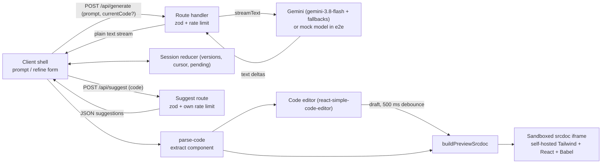

English | [Português (BR)](README.pt-BR.md)

# UIForge

Describe a UI component in plain language and watch React + Tailwind code stream in live, with a sandboxed preview next to it. Then keep refining it: every change becomes a new version you can undo, restore or edit by hand.

## Badges and live demo

[](https://github.com/matheusosf11/uiforge/actions/workflows/ci.yml)
[](LICENSE)

Live demo: https://uiforge-orlasup-project.vercel.app

## Demo and screenshots


Recorded from the deterministic mock model (`npm run demo:gif`): type a prompt, generate, refine with a suggestion chip, undo, then edit the code by hand while the preview updates.


The site is dark-only. Both assets are captured with the mock model, so the component shown is a fixed fixture (see [docs/README.md](docs/README.md)).

## Features

- Prompt (up to 2,000 characters) with example chips; the code streams in token by token from Gemini.
- Live preview of the generated component inside a sandboxed iframe.
- Iterative refinement: after v1 the input switches to "Refinar" and sends the current code plus your instruction; the model returns the whole updated component, which becomes the next version. "Novo componente" starts over, and asks for confirmation when there are several versions or manual edits.
- AI suggestion chips: after each version, `/api/suggest` proposes up to 4 short changes; clicking a chip prefills the instruction (a fixed list is used when the model is unavailable).
- Version history: a list of every version (prompt, refine instruction or "Edição manual"). You can restore any version; later versions are shown dimmed, and refining from an earlier one says so ("Refinar a partir da vN") before discarding them. The latest 20 versions are kept, with stable numbering. Undo with the "Desfazer" button or Ctrl/⌘+Z outside the editor.
- Editable code: the code panel is an editor (read-only while streaming). Edits show an "Editado" badge and a draft row, update the preview after a 500 ms debounce, and are saved as an "Edição manual" version before the next refine. Copy and download (`.tsx`) export the edited code. Press Esc then Tab to leave the editor (Tab is not trapped).
- Stop button (aborts the provider request), friendly error alert with retry (a failed refine keeps the previous version), and a rate-limit message.
- Dark-only UI with an animated topology background and a decorative interactive 3D robot mascot on wide screens (1536px and up, hidden when reduced motion is requested); mobile layout with Preview / Code tabs.

## Note on language

The UI of the app is in Portuguese (labels such as "Gerar", "Refinar", "Pronto", "Baixar"). This README and the code are in English, with a Portuguese mirror in [README.pt-BR.md](README.pt-BR.md).

## Getting started

Requirements: Node 22 (see `.nvmrc`; with nvm run `nvm use`).

```bash
npm ci
cp .env.example .env.local
# edit .env.local and set GOOGLE_GENERATIVE_AI_API_KEY
npm run dev
```

Get a free Gemini API key from [Google AI Studio](https://aistudio.google.com/apikey). The key is server-side only; never prefix it with `NEXT_PUBLIC_`.

Optional environment variables for the per-IP rate limits (each route has its own bucket):

- `RATE_LIMIT_MAX` (default 5 requests) and `RATE_LIMIT_WINDOW_MS` (default 60000) for `/api/generate`
- `DAILY_LIMIT_MAX` (default 60 generations per IP per day) for `/api/generate`, so one client or script cannot spend the whole free model quota
- `SUGGEST_RATE_LIMIT_MAX` (default 10 requests) and `SUGGEST_RATE_LIMIT_WINDOW_MS` (default 60000) for `/api/suggest`
- `UPSTASH_REDIS_REST_URL` and `UPSTASH_REDIS_REST_TOKEN` (optional, server-only): when both are set, the limits are counted in Upstash Redis and shared by every serverless instance. Without them, or when Redis does not answer within 1 s, each instance falls back to its in-memory limiter. A free Upstash database is enough.

Useful scripts: `npm test`, `npm run typecheck`, `npm run lint`, `npm run test:coverage`, `npm run check:secrets` (after a build: no keys in the browser bundle or tracked files), `npm run e2e`, `npm run demo:gif` (records the demo GIF; requires `ffmpeg` on PATH).

## Architecture



Walk-through:

- `src/lib/session.ts` is a pure reducer for the session: the list of versions, the cursor (the version being shown), the pending request, the 20-version cap and stable numbering (evicted versions offset the display numbers). Restoring a version moves the cursor; a refine or a manual edit from an earlier version truncates the later ones.
- `src/components/generator/use-generator-session.ts` wraps the reducer in a hook that runs the requests (generate or refine), handles abort, errors and rate limits, and commits a manual edit before refining.
- `src/components/generator/generator-shell.tsx` composes the page: prompt/refine form, session bar (undo, "Novo componente"), version list, suggestion chips, code editor and preview, plus the confirmation dialogs and the Ctrl/⌘+Z shortcut. It reads the response body as a plain text stream.
- `src/app/api/generate/route.ts` (Node runtime, `maxDuration = 60`) validates the body with zod, rejects oversize code, applies the rate limit, then calls `streamText`. It tries the models in order (`gemini-3.8-flash`, then `gemini-3.6-flash`, then `gemini-3.5-flash-lite`) and peeks until the first text delta, so provider failures become real HTTP statuses (or fall through to the next model) before any byte is sent; later failures error the stream so the client shows the alert and retry instead of a truncated "Pronto".
- `src/app/api/suggest/route.ts` (Node runtime, `maxDuration = 30`) returns up to 4 suggestions as JSON, using `generateText` with a structured output and the shared helpers in `src/lib/suggest.ts`.
- `src/lib/ai/model.ts` is the single place that picks the models. When `UIFORGE_E2E_MOCK=1` (and not on Vercel Production) it dynamically imports `mock-model.ts`, a deterministic fixture used by e2e.
- `src/lib/parse-code.ts` extracts the component code from the stream.
- `src/components/generator/code-view.tsx` is the code panel: syntax highlighting with prism inside `react-simple-code-editor`, read-only while streaming, with the draft badge, discard, copy and download.
- `src/lib/preview-srcdoc.ts` rewrites the React imports and default export, then builds a full HTML document that loads pinned builds of Tailwind (browser build 4.3.3), React 18.3.1 and Babel standalone 7.28.5, self-hosted from `public/preview-runtime`, transpiles the code in the iframe and mounts it.
- `src/components/generator/sandbox-preview.tsx` renders that document as `<iframe sandbox="allow-scripts" srcDoc=...>` with `color-scheme: light`, listens for error messages posted by the iframe and shows an alert with reload if the runtime never finishes loading.

## API

Both routes take JSON bodies (`content-type: application/json`, otherwise `415`), refuse requests that a browser marks as coming from another site (`403` `forbidden`, from `Sec-Fetch-Site` or a mismatched `Origin`), apply a per-IP rate limit and never expose provider error messages.

### POST /api/generate

- Request: `{ "prompt": string, "currentCode"?: string }`. `prompt` is required, non-blank and at most 2,000 characters. Without `currentCode` (or with a blank one) it generates a new component; with `currentCode` it runs in refine mode and `prompt` is the change to apply.
- `currentCode` is at most 30,000 characters. It is sent to the model inside delimiters and treated as data, not instructions.
- Response: `200` with a plain text stream (not the UI-message protocol). In refine mode the stream is the full updated component, not a diff.
- Errors:
  - `400` invalid body;
  - `413` `code_too_large` (code over 30,000 characters or a body over 256,000 bytes), checked before the rate limit so it costs no quota;
  - `429` with a `Retry-After` header (in seconds) and a body that says which limit was hit: `rate_limited` (per minute), `daily_limit` (per day) or `quota_exhausted` (the provider's own free quota). The client turns each into a friendly pt-BR message (for example "Aguarde 42 segundos e tente de novo"), never a technical error;
  - `500` missing API key;
  - `502` `generate_failed` when every model fails before the first byte. Failures after the first byte error the stream.

### POST /api/suggest

- Request: `{ "code": string }`, non-blank, at most 30,000 characters.
- Response: `200` with `{ "suggestions": [{ "label": string, "instruction": string }] }`: at most 4 suggestions, labels up to 30 characters and instructions up to 300.
- Cache: the answer for the same code is kept in the instance's memory (up to 200 entries), so undo/redo and repeated versions cost no model call and no quota.
- Rate limit: its own bucket, separate from generate (`SUGGEST_RATE_LIMIT_MAX`, default 10, per `SUGGEST_RATE_LIMIT_WINDOW_MS`, default 60000).
- Timeouts: the server tries `gemini-3.5-flash-lite`, then `gemini-3.6-flash`, each capped at 5 s, inside a 9 s total budget. The client waits up to 12 s (the budget plus 3 s of headroom).
- Errors: `400`, `413` `code_too_large`, `429` with `Retry-After`, `500` missing key, `502` `suggest_failed`.
- Fallback: when the request fails or returns fewer than 4 items, the client fills the chips from a fixed pt-BR list: "Modo escuro", "Mais espaçamento", "Adicionar ícone", "Animação no hover". In e2e the mock returns a different fixed list.

## Sandbox threat model

Generated code is untrusted: it is model output that runs JavaScript. The preview is an iframe with `sandbox="allow-scripts"` and deliberately without `allow-same-origin`.

What this isolates:

- The iframe gets an opaque origin: it cannot read the host DOM, cookies, localStorage or sessionStorage.
- It cannot navigate the top-level page (no `allow-top-navigation`) and popups are blocked (no `allow-popups`); forms and modals are also not allowed.
- The only channel back to the host is `postMessage`. The host handles it one way and renders the message as text in a React element. A grep of `src` finds no `dangerouslySetInnerHTML`, so nothing from the model is injected into the host as HTML.
- A unit test asserts the sandbox attribute does not include `allow-same-origin`.

What it does NOT protect against (residual risks):

- CPU use and infinite loops: a runaway script can freeze the preview and the browser tab, because the iframe shares the renderer budget of the tab. There is no watchdog.
- Outbound network: scripts in the iframe can still make requests (for example to exfiltrate what the user types into the generated UI).
- Deceptive UI: generated markup can look like a login form or other phishing-style content inside the preview frame.
- Supply chain of the preview runtime: Tailwind, React and Babel are pinned files vendored in `public/preview-runtime` and served from the app's own origin, without Subresource Integrity hashes.
- The host's message listener only accepts messages whose `source` is one of its own preview frames and whose origin is the sandbox's opaque `"null"`; anything else (another tab, an extension, the page itself) is ignored.

## Trade-offs

- Gemini free tier: no cost, but limited quota and latency; the model ids live in one file so they can be swapped, and a fallback chain absorbs "high demand" errors.
- srcdoc iframe instead of Sandpack: Sandpack was used first and removed. A hand-built srcdoc keeps the sandbox attribute and the origin model explicit and drops a heavy dependency, at the cost of loading the runtime scripts on every preview.
- Refine returns the whole file, not a diff: simpler and robust to small model mistakes, but long components use more tokens per turn. The 30,000-character limit on `currentCode` bounds this.
- Rate limiting: with Upstash configured the counters are shared (fixed windows, one `INCR` + `PEXPIRE NX` pipeline per bucket). Without it, or when Redis is down, counters live in one serverless instance and reset on cold starts. The origin check and the JSON-only rule stop other sites and naive scripts, but a determined client can forge headers; the per-IP minute and daily limits are what bound the cost.
- Self-hosted caveat: the per-IP key only trusts forwarded headers (`x-vercel-forwarded-for`, `x-real-ip`, `x-forwarded-for`) when `VERCEL` is set; elsewhere all clients share one bucket, so put a trusted proxy or a real limiter in front.
- Mock model in e2e: tests are deterministic, free and keyless, but they do not exercise the real provider. The switch is an env var only and is ignored on Vercel Production.
- Dark host, light preview: the site is dark-only, but generated components usually assume a white background, so the iframe stays light.
- Session in memory: versions live in React state and are lost on reload.
- Vercel Hobby: `maxDuration = 60` stays well inside the 300 second limit and avoids truncating the stream.

## Testing strategy

- Unit and component tests with Vitest and React Testing Library: parse-code, srcdoc builder, rate limiter, the session reducer (versions, cursor, cap, numbering), the generate route in both modes (refine, `code_too_large`, rate limit, model fallback), the suggest route and helpers, the prompt form, the version list, the code editor and the sandbox attribute.
- End-to-end tests with Playwright against the production build (`next build && next start`), using the mock language model gated by `UIFORGE_E2E_MOCK`:
  - smokes in `e2e/generate.spec.ts`: happy path, mid-stream error with retry, copy and download, mobile tabs, refine and undo, failed refine, restoring an earlier version, editing the code (preview, refine uses the edit, copy exports it, Esc then Tab);
  - `e2e/journey.spec.ts`: one serial test of the full loop (generate, refine, undo, manual edit, refine after the edit, failed refine that keeps the previous version).
- The e2e server port is `E2E_PORT` (default 3100), for machines where that port is taken.
- CI (GitHub Actions) runs two jobs: `check` (lint, typecheck, coverage, build) and `e2e` (Playwright). Coverage has a minimum in `vitest.config.ts` (statements 75%, branches 78%, functions 74%, lines 77%) and the build fails below it. After the build, `npm run check:secrets` fails if a Google API key, a private key or the value of a server-only variable appears in `.next/static` or in a tracked file.
- Docs assets are regenerated on demand and their specs are skipped otherwise:
  - `SCREENSHOTS=1 npx playwright test e2e/screenshots.spec.ts` captures `docs/screenshot-dark.png` (dark only);
  - `npm run demo:gif` runs `e2e/demo.spec.ts` with `DEMO=1` (video at 1600x900) and converts it with a two-pass ffmpeg palette into `docs/demo.gif` (about 960px wide, at most 3 MB). It requires `ffmpeg` on PATH. `npm run demo:gif -- --convert-only` reconverts the last recording, and `DEMO_GIF_SPEED`, `DEMO_GIF_FLOOR`, `DEMO_GIF_START` and `DEMO_GIF_MAX` tune the conversion.

## Deployment

- Vercel Git integration deploys the repository; GitHub Actions only validates, it does not deploy.
- Production uses a separate, Production-only Gemini API key (never the development key).
- Preview deployments without a key fail gracefully with an explicit missing-key error.
- `UIFORGE_E2E_MOCK` must never be set on Vercel.

## What was cut and v2 roadmap

Shipped in v1.1: iterative refinement, version history and editable code.

- Authentication and per-user quotas
- Persistent sessions (versions survive a reload)
- Diff view between versions
- Multi-file components
- Model selector

## License

MIT, see [LICENSE](LICENSE).
