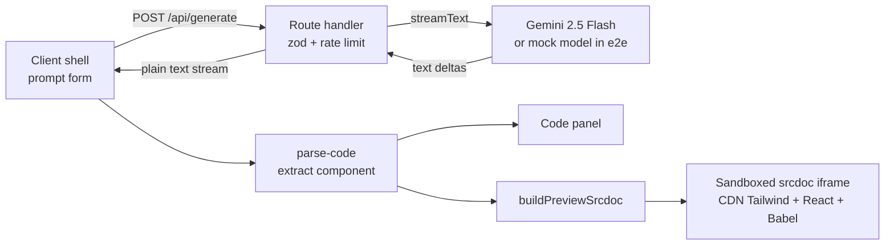

English | [Portugues (BR)](README.pt-BR.md)

# UIForge

Describe a UI component in plain language and watch React + Tailwind code stream in live, with a sandboxed preview next to it.

## Badges and live demo

[](https://github.com/matheusosf11/uiforge/actions/workflows/ci.yml)
[](LICENSE)

Live demo: https://uiforge-orlasup-project.vercel.app

## Screenshots

Host theme: light and dark (captured with the mock model, so the component shown is a fixed fixture).


<!-- Demo GIF placeholder (prompt -> streaming -> preview): record it after deploy and save it as docs/demo.gif, then uncomment the line below. -->
<!--  -->

## Features

- Prompt (up to 2000 characters) with example chips; the code streams in token by token from Gemini.
- Live preview of the generated component inside a sandboxed iframe.
- Syntax-highlighted code panel with copy and download (`.tsx`).
- Stop button (aborts the provider request), friendly error alert with retry, and a rate-limit message.
- Dark/light host theme; mobile layout with Preview / Code tabs.

## Note on language

The UI of the app is in Portuguese (labels such as "Gerar", "Pronto", "Baixar"). This README and the code are in English, with a Portuguese mirror in [README.pt-BR.md](README.pt-BR.md).

## Getting started

Requirements: Node 22 (see `.nvmrc`; with nvm run `nvm use`).

```bash
npm ci
cp .env.example .env.local
# edit .env.local and set GOOGLE_GENERATIVE_AI_API_KEY
npm run dev
```

Get a free Gemini API key from [Google AI Studio](https://aistudio.google.com/apikey). The key is server-side only; never prefix it with `NEXT_PUBLIC_`.

Optional environment variables for the per-IP rate limit on `/api/generate`:

- `RATE_LIMIT_MAX` (default 5 requests)
- `RATE_LIMIT_WINDOW_MS` (default 60000)

Useful scripts: `npm test`, `npm run typecheck`, `npm run lint`, `npm run test:coverage`, `npm run e2e`.

## Architecture



Walk-through:

- `src/components/generator/generator-shell.tsx` owns the client state (idle, streaming, finished, error) and reads the response body as a plain text stream.
- `src/app/api/generate/route.ts` (Node runtime, `maxDuration = 60`) validates the body with zod, applies the rate limit, then calls `streamText`. It peeks until the first text delta so provider failures (for example 429) become real HTTP statuses before any byte is sent; later failures error the stream so the client shows the alert and retry instead of a truncated "Pronto".
- `src/lib/ai/model.ts` is the single place that picks the model (`gemini-3.8-flash`). When `UIFORGE_E2E_MOCK=1` (and not on Vercel Production) it dynamically imports `mock-model.ts`, a deterministic fixture used by e2e.
- `src/lib/parse-code.ts` extracts the component code from the stream.
- `src/lib/preview-srcdoc.ts` rewrites the React imports and default export, then builds a full HTML document that loads pinned CDN builds of Tailwind (browser build), React 18.3.1 and Babel standalone, transpiles the code in the iframe and mounts it.
- `src/components/generator/sandbox-preview.tsx` renders that document as `<iframe sandbox="allow-scripts" srcDoc=...>` with `color-scheme: light`, and listens for error messages posted by the iframe.

## Sandbox threat model

Generated code is untrusted: it is model output that runs JavaScript. The preview is an iframe with `sandbox="allow-scripts"` and deliberately without `allow-same-origin`.

What this isolates:

- The iframe gets an opaque origin: it cannot read the host DOM, cookies, localStorage or sessionStorage.
- It cannot navigate the top-level page (no `allow-top-navigation`) and popups are blocked (no `allow-popups`); forms and modals are also not allowed.
- The only channel back to the host is `postMessage`. The host handles it one way and renders the message as text in a React element. A grep of `src` finds no `dangerouslySetInnerHTML`, so nothing from the model is injected into the host as HTML.
- A unit test asserts the sandbox attribute does not include `allow-same-origin`.

What it does NOT protect against (residual risks):

- CPU use and infinite loops: a runaway script can freeze the preview and the browser tab, because the iframe shares the renderer budget of the tab. There is no watchdog.
- Outbound network: scripts in the iframe can still make requests (for example to exfiltrate what the user types into the generated UI).
- Deceptive UI: generated markup can look like a login form or other phishing-style content inside the preview frame.
- CDN supply chain: the preview loads Tailwind, React and Babel from jsDelivr with pinned versions but without Subresource Integrity hashes.
- The host's message listener does not verify the sender window; the worst a spoofed message can do is show a text error line.

## Trade-offs

- Gemini free tier: no cost, but limited quota and latency; the model id lives in one constant so it can be swapped.
- srcdoc iframe instead of Sandpack: Sandpack was used first and removed. A hand-built srcdoc keeps the sandbox attribute and the origin model explicit and drops a heavy dependency, at the cost of relying on CDN scripts at runtime.
- Rate limiting is in memory and best-effort: counters live in one serverless instance, are not shared between instances and reset on cold starts. A distributed limiter (PLAT-01, for example Upstash) is the real fix and is left for v2.
- Mock model in e2e: tests are deterministic, free and keyless, but they do not exercise the real provider. The switch is an env var only and is ignored on Vercel Production.
- Always-light preview: generated components usually assume a white background, so the iframe is forced to light regardless of the host theme.
- CDN dependency of the preview: offline use or a CDN outage breaks the preview (the code panel keeps working).
- Vercel Hobby: `maxDuration = 60` stays well inside the 300 second limit and avoids truncating the stream.

## Testing strategy

- Unit and component tests with Vitest and React Testing Library (parse-code, srcdoc builder, rate limiter, prompt form, sandbox attribute).
- End-to-end tests with Playwright against the production build (`next build && next start`), using the mock language model gated by `UIFORGE_E2E_MOCK`: happy path, mid-stream error with retry, copy and download, mobile tabs.
- CI (GitHub Actions) runs two jobs: `check` (lint, typecheck, coverage, build) and `e2e` (Playwright). Coverage is reported without a threshold.
- Screenshots are regenerated on demand with `SCREENSHOTS=1 npx playwright test e2e/screenshots.spec.ts`; the spec is skipped otherwise.

## Deployment

- Vercel Git integration deploys the repository; GitHub Actions only validates, it does not deploy.
- Production uses a separate, Production-only Gemini API key (never the development key).
- Preview deployments without a key fail gracefully with an explicit missing-key error.
- `UIFORGE_E2E_MOCK` must never be set on Vercel.

## What was cut and v2 roadmap

- Authentication and per-user quotas
- Generation history
- Iterative refinement (follow-up prompts on the same component)
- Distributed rate limiting (PLAT-01)
- Multi-file components
- Model selector

## License

MIT, see [LICENSE](LICENSE).
