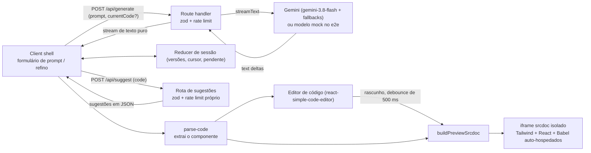

[English](README.md) | Português (BR)

# UIForge

Descreva um componente de interface em linguagem natural e veja o código React + Tailwind ser gerado ao vivo, com um preview isolado ao lado. Depois continue refinando: cada mudança vira uma nova versão que você pode desfazer, restaurar ou editar à mão.

## Badges e demo ao vivo

[](https://github.com/matheusosf11/uiforge/actions/workflows/ci.yml)
[](LICENSE)

Demo ao vivo: https://uiforge-orlasup-project.vercel.app

## Demo e screenshots


Gravado com o modelo mock determinístico (`npm run demo:gif`): digitar um prompt, gerar, refinar com um chip de sugestão, desfazer e editar o código à mão enquanto o preview atualiza.


O site é apenas escuro. Os dois arquivos são capturados com o modelo mock, então o componente exibido é uma fixture fixa (veja [docs/README.md](docs/README.md)).

## Funcionalidades

- Prompt (até 2.000 caracteres) com uma galeria de exemplos: 24 prompts completos, prontos para gerar, em seis categorias (Cards, Formulários, Dashboards, Tabelas, Menus, Básicos); o código chega token a token do Gemini.
- Até 4 imagens de referência (escolhidas, coladas ou arrastadas) enviadas junto com o prompt.
- Um guia de design no prompt do sistema (uma cor de destaque, escala de espaçamento, cantos, estados de foco, conteúdo realista em pt-BR, layout responsivo, variantes `dark:`, acessibilidade) para resultados mais caprichados e consistentes.
- Preview ao vivo do componente gerado dentro de um iframe isolado (sandbox), na largura Desktop, Tablet (768px) ou Celular (375px) e em página clara ou escura (as classes `dark:` acompanham).
- Refinamento iterativo: depois da v1 o campo passa para "Refinar" e envia o código atual junto com a sua instrução; o modelo devolve o componente inteiro atualizado, que vira a próxima versão. "Novo componente" recomeça do zero e pede confirmação quando há várias versões ou edições manuais.
- Chips de sugestão por IA: depois de cada versão, `/api/suggest` propõe até 4 mudanças curtas; clicar em um chip preenche a instrução (uma lista fixa é usada quando o modelo não está disponível).
- Histórico de versões: uma lista com todas as versões (prompt, instrução de refino ou "Edição manual"). Dá para restaurar qualquer versão; as versões posteriores aparecem esmaecidas, e refinar a partir de uma anterior avisa isso ("Refinar a partir da vN") antes de descartá-las. As 20 versões mais recentes são mantidas, com numeração estável. Desfaça com o botão "Desfazer" ou Ctrl/⌘+Z fora do editor.
- Código editável: o painel de código é um editor (somente leitura durante o streaming). Edições mostram o badge "Editado" e uma linha de rascunho, atualizam o preview após um debounce de 500 ms e são salvas como uma versão "Edição manual" antes do próximo refino. Copiar e baixar (`.tsx`) exportam o código editado. Pressione Esc e depois Tab para sair do editor (o Tab não fica preso).
- Projetos salvos no navegador: cada versão é salva automaticamente no localStorage (até 20 projetos) e o último reabre depois de recarregar; "Projetos" lista todos para abrir ou excluir. Sem conta e sem enviar nada ao servidor.
- Comparar: diff por linha entre duas versões quaisquer, só com as mudanças ou com o arquivo inteiro.
- Editor visual: troque a cor de destaque e os tons neutros, os cantos, o espaçamento, o tamanho do texto, as bordas e a fonte sem escrever prompt; o preview acompanha e "Salvar como versão" guarda o resultado (sem chamar o modelo).
- "Como usar": passos para usar o componente em outro projeto e um `.zip` com o componente e um README.
- Botão de parar (aborta a requisição ao provedor), alerta de erro amigável com nova tentativa (um refino que falha mantém a versão anterior) e mensagem de rate limit.
- Interface apenas escura, com fundo de topologia animado e um mascote robô 3D interativo e decorativo em telas largas (a partir de 1536px, oculto quando o sistema pede movimento reduzido); layout mobile com abas Preview / Código.

## Nota sobre o idioma

A interface do app está em português (rótulos como "Gerar", "Refinar", "Pronto", "Baixar"). Este README e o código estão em inglês, com este espelho em português; a versão canônica é o [README.md](README.md).

## Primeiros passos

Requisitos: Node 22 (veja `.nvmrc`; com nvm rode `nvm use`).

```bash
npm ci
cp .env.example .env.local
# edite .env.local e defina GOOGLE_GENERATIVE_AI_API_KEY
npm run dev
```

Obtenha uma chave gratuita do Gemini no [Google AI Studio](https://aistudio.google.com/apikey). A chave é apenas do servidor; nunca use o prefixo `NEXT_PUBLIC_`.

Variáveis de ambiente opcionais para os rate limits por IP (cada rota tem o seu bucket):

- `RATE_LIMIT_MAX` (padrão 5 requisições) e `RATE_LIMIT_WINDOW_MS` (padrão 60000) para `/api/generate`
- `DAILY_LIMIT_MAX` (padrão 60 gerações por IP por dia) para `/api/generate`, para que um cliente ou script não gaste toda a cota gratuita do modelo
- `SUGGEST_RATE_LIMIT_MAX` (padrão 10 requisições) e `SUGGEST_RATE_LIMIT_WINDOW_MS` (padrão 60000) para `/api/suggest`
- `UPSTASH_REDIS_REST_URL` e `UPSTASH_REDIS_REST_TOKEN` (opcionais, só do servidor): com as duas definidas, os limites são contados no Upstash Redis e compartilhados por todas as instâncias serverless. Sem elas, ou quando o Redis não responde em 1 s, cada instância volta para o limitador em memória. Um banco gratuito do Upstash basta.

Scripts úteis: `npm test`, `npm run typecheck`, `npm run lint`, `npm run test:coverage`, `npm run check:secrets` (depois de um build: nenhuma chave no bundle do navegador nem nos arquivos versionados), `npm run e2e`, `npm run demo:gif` (grava o GIF de demo; exige `ffmpeg` no PATH).

## Arquitetura



Visão geral:

- `src/lib/session.ts` é um reducer puro da sessão: a lista de versões, o cursor (a versão exibida), a requisição pendente, o limite de 20 versões e a numeração estável (versões removidas deslocam os números exibidos). Restaurar uma versão move o cursor; um refino ou uma edição manual a partir de uma versão anterior descarta as posteriores.
- `src/components/generator/use-generator-session.ts` envolve o reducer em um hook que dispara as requisições (gerar ou refinar), trata abort, erros e rate limit, e salva a edição manual antes de refinar.
- `src/components/generator/generator-shell.tsx` monta a página: formulário de prompt/refino, barra de sessão (desfazer, "Novo componente"), lista de versões, chips de sugestão, editor de código e preview, além dos diálogos de confirmação e do atalho Ctrl/⌘+Z. Ele lê o corpo da resposta como stream de texto puro.
- `src/app/api/generate/route.ts` (runtime Node, `maxDuration = 60`) valida o corpo com zod, rejeita código grande demais, aplica o rate limit e chama `streamText`. Ele tenta os modelos em ordem (`gemini-3.8-flash`, depois `gemini-3.6-flash`, depois `gemini-3.5-flash-lite`) e espia até o primeiro text delta, para que falhas do provedor virem status HTTP reais (ou passem para o próximo modelo) antes de qualquer byte ser enviado; falhas posteriores fazem o stream dar erro, e o cliente mostra o alerta com nova tentativa em vez de um "Pronto" truncado.
- `src/app/api/suggest/route.ts` (runtime Node, `maxDuration = 30`) devolve até 4 sugestões em JSON, usando `generateText` com saída estruturada e os helpers compartilhados de `src/lib/suggest.ts`.
- `src/lib/ai/model.ts` é o único ponto que escolhe os modelos. Com `UIFORGE_E2E_MOCK=1` (e fora da Vercel Production) ele importa dinamicamente `mock-model.ts`, uma fixture determinística usada no e2e.
- `src/lib/parse-code.ts` extrai o código do componente do stream.
- `src/components/generator/code-view.tsx` é o painel de código: destaque de sintaxe com prism dentro do `react-simple-code-editor`, somente leitura durante o streaming, com o badge de rascunho, descartar, copiar e baixar.
- `src/lib/preview-srcdoc.ts` reescreve os imports do React e o export default, e monta um documento HTML completo que carrega builds com versões fixas de Tailwind (build para navegador 4.3.3), React 18.3.1 e Babel standalone 7.28.5, auto-hospedados em `public/preview-runtime`, transpila o código dentro do iframe e o monta.
- `src/components/generator/sandbox-preview.tsx` renderiza esse documento como `<iframe sandbox="allow-scripts" srcDoc=...>` com `color-scheme: light`, escuta as mensagens de erro enviadas pelo iframe e mostra um alerta com recarregar se o runtime nunca termina de carregar.

## API

As duas rotas recebem corpo JSON (`content-type: application/json`, senão `415`), recusam requisições que o navegador marca como vindas de outro site (`403` `forbidden`, pelo `Sec-Fetch-Site` ou por um `Origin` diferente), aplicam rate limit por IP e nunca expõem mensagens de erro do provedor.

### POST /api/generate

- Requisição: `{ "prompt": string, "currentCode"?: string }`. `prompt` é obrigatório, não pode ficar em branco e tem no máximo 2.000 caracteres. Sem `currentCode` (ou com um em branco) gera um componente novo; com `currentCode` roda em modo refino e `prompt` é a mudança a aplicar.
- `currentCode` tem no máximo 30.000 caracteres. Ele vai para o modelo entre delimitadores e é tratado como dado, não como instrução.
- Resposta: `200` com um stream de texto puro (não o protocolo de UI messages). No modo refino o stream é o componente inteiro atualizado, não um diff.
- Erros:
  - `400` corpo inválido;
  - `413` `code_too_large` (código acima de 30.000 caracteres ou corpo acima de 256.000 bytes), verificado antes do rate limit para não gastar cota;
  - `429` com header `Retry-After` (em segundos) e um corpo que diz qual limite foi atingido: `rate_limited` (por minuto), `daily_limit` (por dia) ou `quota_exhausted` (a cota gratuita do próprio provedor). O cliente transforma cada um em uma mensagem amigável em pt-BR (por exemplo "Aguarde 42 segundos e tente de novo"), nunca em um erro técnico;
  - `500` chave de API ausente;
  - `502` `generate_failed` quando todos os modelos falham antes do primeiro byte. Falhas depois do primeiro byte fazem o stream dar erro.

### POST /api/suggest

- Requisição: `{ "code": string }`, não pode ficar em branco, no máximo 30.000 caracteres.
- Resposta: `200` com `{ "suggestions": [{ "label": string, "instruction": string }] }`: no máximo 4 sugestões, rótulos de até 30 caracteres e instruções de até 300.
- Cache: a resposta para o mesmo código fica na memória da instância (até 200 entradas), então desfazer/refazer e versões repetidas não chamam o modelo nem gastam cota.
- Rate limit: bucket próprio, separado do generate (`SUGGEST_RATE_LIMIT_MAX`, padrão 10, por `SUGGEST_RATE_LIMIT_WINDOW_MS`, padrão 60000).
- Timeouts: o servidor tenta `gemini-3.5-flash-lite` e depois `gemini-3.6-flash`, cada um limitado a 5 s, dentro de um orçamento total de 9 s. O cliente espera até 12 s (o orçamento mais 3 s de folga).
- Erros: `400`, `413` `code_too_large`, `429` com `Retry-After`, `500` chave ausente, `502` `suggest_failed`.
- Fallback: quando a requisição falha ou devolve menos de 4 itens, o cliente completa os chips com uma lista fixa em pt-BR: "Modo escuro", "Mais espaçamento", "Adicionar ícone", "Animação no hover". No e2e o mock devolve outra lista fixa.

## Modelo de ameaças do sandbox

O código gerado não é confiável: é saída de modelo que executa JavaScript. O preview é um iframe com `sandbox="allow-scripts"` e deliberadamente sem `allow-same-origin`.

O que isso isola:

- O iframe recebe uma origem opaca: não lê o DOM do host, cookies, localStorage nem sessionStorage.
- Não consegue navegar a página de nível superior (sem `allow-top-navigation`) e popups são bloqueados (sem `allow-popups`); formulários e modais também não são permitidos.
- O único canal de volta ao host é `postMessage`. O host o trata em mão única e exibe a mensagem como texto em um elemento React. Um grep em `src` não encontra `dangerouslySetInnerHTML`, então nada vindo do modelo é injetado no host como HTML.
- Um teste unitário garante que o atributo sandbox não inclui `allow-same-origin`.

O que NÃO protege (riscos residuais):

- Uso de CPU e loops infinitos: um script descontrolado pode travar o preview e a aba do navegador, pois o iframe divide o orçamento do renderer da aba. Não há watchdog.
- Rede de saída: scripts no iframe ainda podem fazer requisições (por exemplo para exfiltrar o que o usuário digita na UI gerada).
- UI enganosa: o markup gerado pode imitar um formulário de login ou outro conteúdo de phishing dentro do quadro do preview.
- Cadeia de suprimentos do runtime do preview: Tailwind, React e Babel são arquivos com versões fixas copiados para `public/preview-runtime` e servidos pela própria origem do app, sem hashes de Subresource Integrity.
- O listener de mensagens do host só aceita mensagens cujo `source` é um dos seus próprios quadros de preview e cuja origem é a origem opaca `"null"` do sandbox; qualquer outra (outra aba, uma extensão, a própria página) é ignorada.

## Trade-offs

- Free tier do Gemini: sem custo, porém com cota e latência limitadas; os ids dos modelos ficam em um único arquivo para facilitar a troca, e uma cadeia de fallback absorve erros de "alta demanda".
- iframe srcdoc em vez de Sandpack: o Sandpack foi usado primeiro e removido. Um srcdoc feito à mão mantém explícitos o atributo sandbox e o modelo de origem e elimina uma dependência pesada, ao custo de carregar os scripts do runtime a cada preview.
- O refino devolve o arquivo inteiro, não um diff: mais simples e robusto a pequenos erros do modelo, mas componentes longos gastam mais tokens por rodada. O limite de 30.000 caracteres em `currentCode` limita isso.
- Rate limit: com o Upstash configurado os contadores são compartilhados (janelas fixas, um pipeline `INCR` + `PEXPIRE NX` por bucket). Sem ele, ou com o Redis fora do ar, os contadores vivem em uma instância serverless e zeram em cold starts. A checagem de origem e a regra de só aceitar JSON barram outros sites e scripts simples, mas um cliente determinado consegue forjar headers; os limites por minuto e por dia por IP são o que limita o custo.
- Ressalva para self-hosting: a chave por IP só confia em headers encaminhados (`x-vercel-forwarded-for`, `x-real-ip`, `x-forwarded-for`) quando `VERCEL` está definido; fora da Vercel todos os clientes compartilham um bucket, então use um proxy confiável ou um limitador real à frente.
- Modelo mock no e2e: os testes são determinísticos, gratuitos e sem chave, mas não exercitam o provedor real. A chave de ativação é só uma variável de ambiente e é ignorada na Vercel Production.
- Host escuro, preview claro por padrão: o site é apenas escuro, mas componentes gerados costumam assumir fundo branco, então o iframe começa claro; o botão do preview troca para uma página escura com a classe `dark` no html.
- Projetos locais: as versões ficam no localStorage deste navegador, então não vão para outro dispositivo e somem se os dados do site forem limpos. As imagens de referência não são salvas (os marcadores ficam no código). Com o armazenamento cheio, os projetos mais antigos saem primeiro.
- Editor visual por reescrita de classes: ele troca utilitários do Tailwind com expressões regulares, então classes montadas em tempo de execução (template strings, condicionais) ficam como estão.
- Vercel Hobby: `maxDuration = 60` fica bem dentro do limite de 300 segundos e evita truncar o stream.

## Estratégia de testes

- Testes unitários e de componente com Vitest e React Testing Library: parse-code, gerador de srcdoc, rate limiter, o reducer de sessão (versões, cursor, limite, numeração), a rota de generate nos dois modos (refino, `code_too_large`, rate limit, fallback de modelo), a rota e os helpers de sugestão, o formulário de prompt, a lista de versões, o editor de código e o atributo sandbox.
- Testes end-to-end com Playwright contra o build de produção (`next build && next start`), usando o modelo de linguagem mock controlado por `UIFORGE_E2E_MOCK`:
  - smokes em `e2e/generate.spec.ts`: caminho feliz, erro no meio do stream com nova tentativa, copiar e baixar, abas mobile, refinar e desfazer, refino com falha, restaurar uma versão anterior, editar o código (preview, o refino usa a edição, copiar exporta a edição, Esc e depois Tab);
  - `e2e/journey.spec.ts`: um teste serial do ciclo completo (gerar, refinar, desfazer, edição manual, refinar depois da edição, refino com falha que mantém a versão anterior).
- A porta do servidor de e2e é `E2E_PORT` (padrão 3100), para máquinas em que essa porta está ocupada.
- A CI (GitHub Actions) roda dois jobs: `check` (lint, typecheck, cobertura, build) e `e2e` (Playwright). A cobertura tem um mínimo em `vitest.config.ts` (statements 79%, branches 80%, functions 79%, lines 81%) e o build falha abaixo dele. Depois do build, `npm run check:secrets` falha se uma chave de API do Google, uma chave privada ou o valor de uma variável só do servidor aparecer em `.next/static` ou em um arquivo versionado.
- Os arquivos de docs são regenerados sob demanda e os specs deles são ignorados nos outros casos:
  - `SCREENSHOTS=1 npx playwright test e2e/screenshots.spec.ts` captura `docs/screenshot-dark.png` (apenas escuro);
  - `npm run demo:gif` roda `e2e/demo.spec.ts` com `DEMO=1` (vídeo em 1600x900) e o converte com uma paleta do ffmpeg em duas passadas para `docs/demo.gif` (cerca de 960px de largura, no máximo 3 MB). Exige `ffmpeg` no PATH. `npm run demo:gif -- --convert-only` reconverte a última gravação, e `DEMO_GIF_SPEED`, `DEMO_GIF_FLOOR`, `DEMO_GIF_START` e `DEMO_GIF_MAX` ajustam a conversão.

## Deploy

- A integração Git da Vercel faz o deploy do repositório; o GitHub Actions apenas valida, não faz deploy.
- A produção usa uma chave Gemini separada, exclusiva de Production (nunca a chave de desenvolvimento).
- Deploys de Preview sem chave falham de forma controlada, com erro explícito de chave ausente.
- `UIFORGE_E2E_MOCK` nunca deve ser definido na Vercel.

## O que foi cortado e roadmap v2

Entregue na v1.1: refinamento iterativo, histórico de versões e código editável. Entregue na v1.2: rate limit compartilhado (Upstash, opcional), mensagens amigáveis de limite, galeria de exemplos, guia de design para o modelo, projetos locais, diff de versões, tamanhos e página escura no preview, download com guia de uso e editor visual.

- Autenticação e cotas por usuário
- Projetos com múltiplos arquivos (planejado para a v1.3)
- Seletor de modelo

## Licença

MIT, veja [LICENSE](LICENSE).
