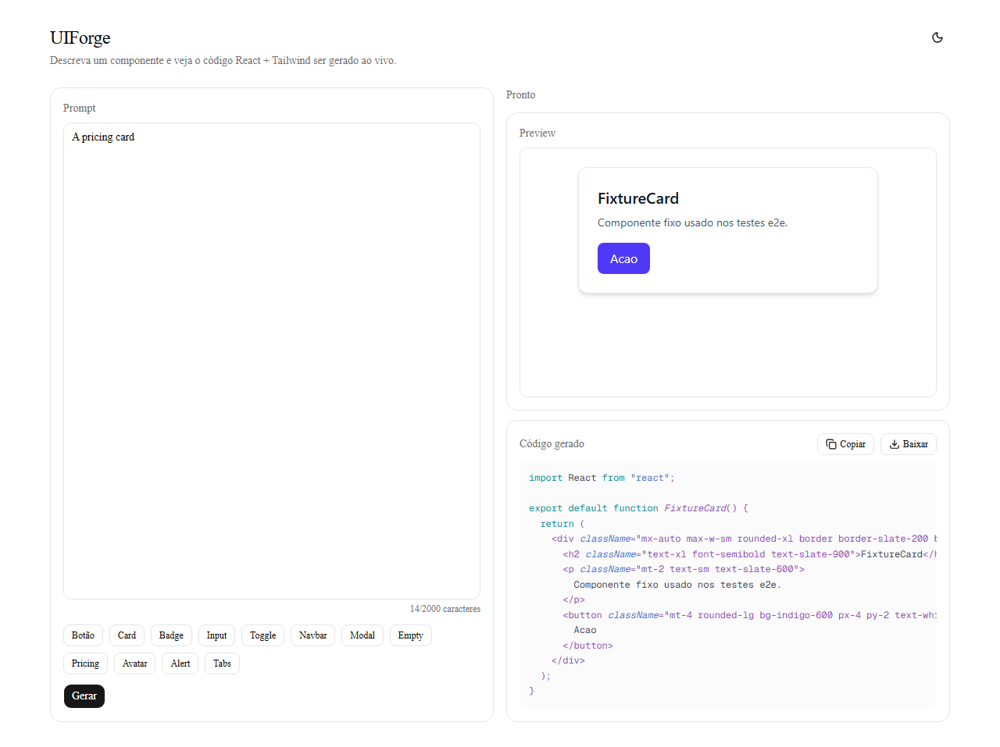
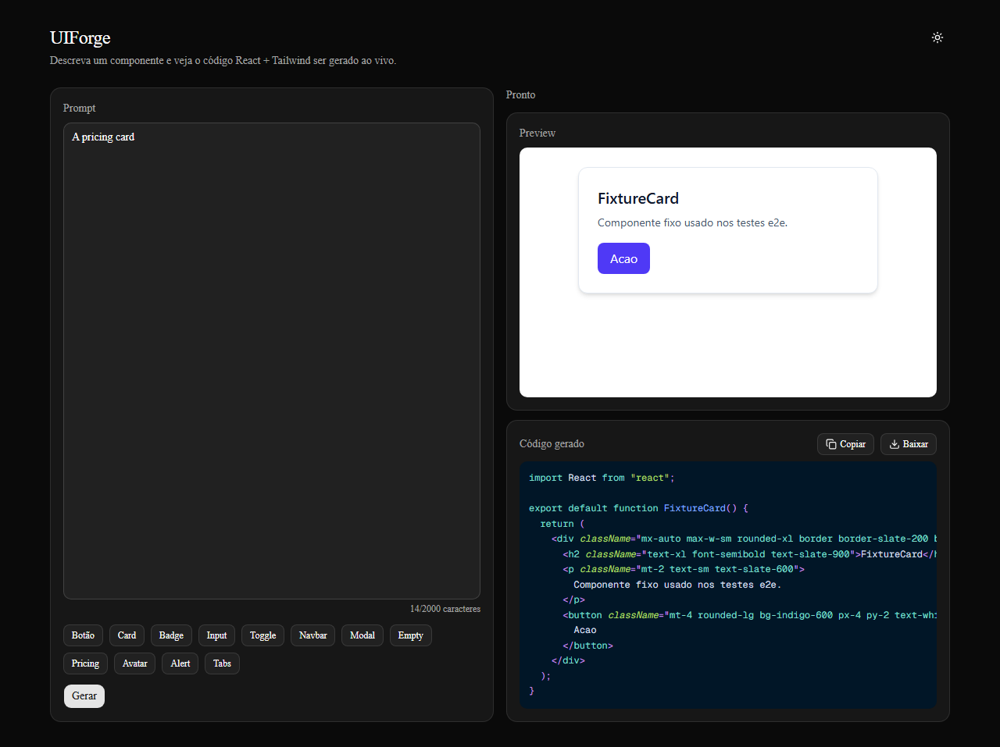
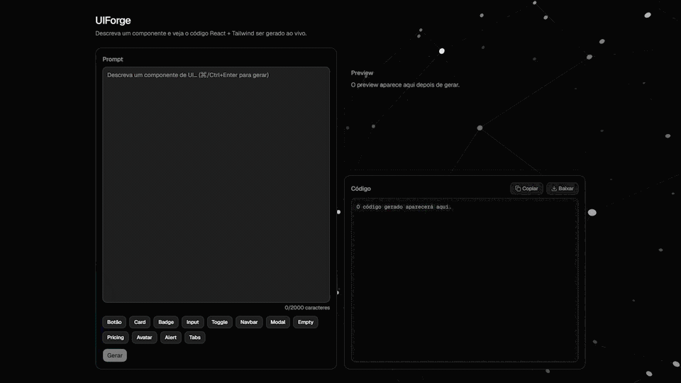
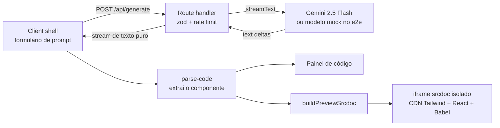

[English](README.md) | Portugues (BR)

# UIForge

Descreva um componente de interface em linguagem natural e veja o código React + Tailwind ser gerado ao vivo, com um preview isolado ao lado.

## Badges e demo ao vivo

[](https://github.com/OWNER/REPO/actions/workflows/ci.yml)
[](LICENSE)

Demo ao vivo: DEPLOY_URL

## Screenshots

Tema do host: claro e escuro (capturados com o modelo mock, então o componente exibido é uma fixture fixa).





<!-- Placeholder do GIF de demo (prompt -> streaming -> preview): grave depois do deploy e salve como docs/demo.gif, então descomente a linha abaixo. -->
<!--  -->

## Funcionalidades

- Prompt (até 2000 caracteres) com chips de exemplo; o código chega token a token do Gemini.
- Preview ao vivo do componente gerado dentro de um iframe isolado (sandbox).
- Painel de código com destaque de sintaxe, copiar e baixar (`.tsx`).
- Botão de parar (aborta a requisição ao provedor), alerta de erro amigável com nova tentativa e mensagem de rate limit.
- Tema escuro/claro no host; layout mobile com abas Preview / Código.

## Nota sobre o idioma

A interface do app está em português (rótulos como "Gerar", "Pronto", "Baixar"). Este README e o código estão em inglês, com este espelho em português; a versão canônica é o [README.md](README.md).

## Primeiros passos

Requisitos: Node 22 (veja `.nvmrc`; com nvm rode `nvm use`).

```bash
npm ci
cp .env.example .env.local
# edite .env.local e defina GOOGLE_GENERATIVE_AI_API_KEY
npm run dev
```

Obtenha uma chave gratuita do Gemini no [Google AI Studio](https://aistudio.google.com/apikey). A chave é apenas do servidor; nunca use o prefixo `NEXT_PUBLIC_`.

Variáveis de ambiente opcionais para o rate limit por IP em `/api/generate`:

- `RATE_LIMIT_MAX` (padrão 5 requisições)
- `RATE_LIMIT_WINDOW_MS` (padrão 60000)

Scripts úteis: `npm test`, `npm run typecheck`, `npm run lint`, `npm run test:coverage`, `npm run e2e`.

## Arquitetura



Visão geral:

- `src/components/generator/generator-shell.tsx` guarda o estado do cliente (ocioso, streaming, finalizado, erro) e lê o corpo da resposta como stream de texto puro.
- `src/app/api/generate/route.ts` (runtime Node, `maxDuration = 60`) valida o corpo com zod, aplica o rate limit e chama `streamText`. Ele espia até o primeiro text delta para que falhas do provedor (por exemplo 429) virem status HTTP reais antes de qualquer byte ser enviado; falhas posteriores fazem o stream dar erro, e o cliente mostra o alerta com nova tentativa em vez de um "Pronto" truncado.
- `src/lib/ai/model.ts` é o único ponto que escolhe o modelo (`gemini-2.5-flash`). Com `UIFORGE_E2E_MOCK=1` (e fora da Vercel Production) ele importa dinamicamente `mock-model.ts`, uma fixture determinística usada no e2e.
- `src/lib/parse-code.ts` extrai o código do componente do stream.
- `src/lib/preview-srcdoc.ts` reescreve os imports do React e o export default, e monta um documento HTML completo que carrega builds de CDN com versões fixas de Tailwind (build para navegador), React 18.3.1 e Babel standalone, transpila o código dentro do iframe e o monta.
- `src/components/generator/sandbox-preview.tsx` renderiza esse documento como `<iframe sandbox="allow-scripts" srcDoc=...>` com `color-scheme: light` e escuta as mensagens de erro enviadas pelo iframe.

## Modelo de ameaças do sandbox

O código gerado não é confiável: é saída de modelo que executa JavaScript. O preview é um iframe com `sandbox="allow-scripts"` e deliberadamente sem `allow-same-origin`.

O que isso isola:

- O iframe recebe uma origem opaca: não lê o DOM do host, cookies, localStorage nem sessionStorage.
- Não consegue navegar a página de nível superior (sem `allow-top-navigation`) e popups são bloqueados (sem `allow-popups`); formulários e modais também não são permitidos.
- O único canal de volta ao host é `postMessage`. O host o trata em mão única e exibe a mensagem como texto em um elemento React. Um grep em `src` não encontra `dangerouslySetInnerHTML`, então nada vindo do modelo é injetado no host como HTML.
- Um teste unitário garante que o atributo sandbox não inclui `allow-same-origin`.

O que NÃO protege (riscos residuais):

- Uso de CPU e loops infinitos: um script descontrolado pode travar o preview e a aba do navegador, pois o iframe divide o orçamento do renderer da aba. Não há watchdog.
- Rede de saída: scripts no iframe ainda podem fazer requisições (por exemplo para exfiltrar o que o usuário digita na UI gerada).
- UI enganosa: o markup gerado pode imitar um formulário de login ou outro conteúdo de phishing dentro do quadro do preview.
- Cadeia de suprimentos da CDN: o preview carrega Tailwind, React e Babel do jsDelivr com versões fixas, mas sem hashes de Subresource Integrity.
- O listener de mensagens do host não verifica a janela de origem; o pior que uma mensagem forjada faz é exibir uma linha de erro em texto.

## Trade-offs

- Free tier do Gemini: sem custo, porém com cota e latência limitadas; o id do modelo fica em uma única constante para facilitar a troca.
- iframe srcdoc em vez de Sandpack: o Sandpack foi usado primeiro e removido. Um srcdoc feito à mão mantém explícitos o atributo sandbox e o modelo de origem e elimina uma dependência pesada, ao custo de depender de scripts de CDN em runtime.
- Rate limit em memória e best-effort: os contadores vivem em uma instância serverless, não são compartilhados entre instâncias e zeram em cold starts. Um limitador distribuído (PLAT-01, por exemplo Upstash) é a correção real e fica para a v2.
- Modelo mock no e2e: os testes são determinísticos, gratuitos e sem chave, mas não exercitam o provedor real. A chave de ativação é só uma variável de ambiente e é ignorada na Vercel Production.
- Preview sempre claro: componentes gerados costumam assumir fundo branco, então o iframe é forçado ao tema claro independentemente do tema do host.
- Dependência de CDN no preview: uso offline ou queda da CDN quebra o preview (o painel de código continua funcionando).
- Vercel Hobby: `maxDuration = 60` fica bem dentro do limite de 300 segundos e evita truncar o stream.

## Estratégia de testes

- Testes unitários e de componente com Vitest e React Testing Library (parse-code, gerador de srcdoc, rate limiter, formulário de prompt, atributo sandbox).
- Testes end-to-end com Playwright contra o build de produção (`next build && next start`), usando o modelo de linguagem mock controlado por `UIFORGE_E2E_MOCK`: caminho feliz, erro no meio do stream com nova tentativa, copiar e baixar, abas mobile.
- A CI (GitHub Actions) roda dois jobs: `check` (lint, typecheck, cobertura, build) e `e2e` (Playwright). A cobertura é reportada sem limite mínimo.
- Os screenshots são regenerados sob demanda com `SCREENSHOTS=1 npx playwright test e2e/screenshots.spec.ts`; caso contrário o spec é ignorado.

## Deploy

- A integração Git da Vercel faz o deploy do repositório; o GitHub Actions apenas valida, não faz deploy.
- A produção usa uma chave Gemini separada, exclusiva de Production (nunca a chave de desenvolvimento).
- Deploys de Preview sem chave falham de forma controlada, com erro explícito de chave ausente.
- `UIFORGE_E2E_MOCK` nunca deve ser definido na Vercel.

## O que foi cortado e roadmap v2

- Autenticação e cotas por usuário
- Histórico de gerações
- Refinamento iterativo (prompts de acompanhamento sobre o mesmo componente)
- Rate limit distribuído (PLAT-01)
- Componentes com múltiplos arquivos
- Seletor de modelo

## Licença

MIT, veja [LICENSE](LICENSE).
